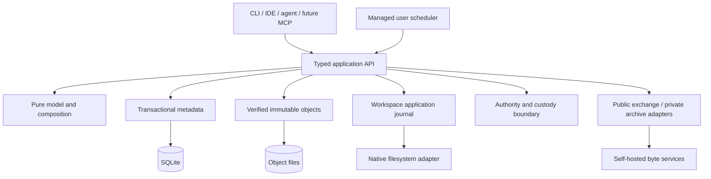
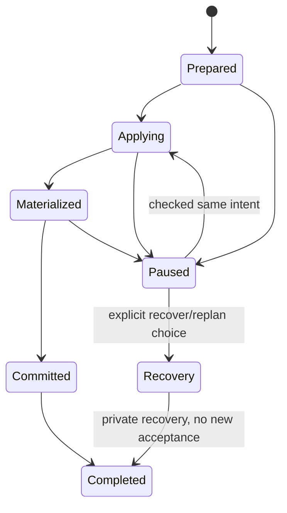

# Yeokcham V2 D2: Python architecture RFC

**Status: DRAFT / NOT YET OWNER-APPROVED**

Date: 2026-11-19, Singapore

Observed HEAD: `a61749f270ed1c65062f7c2845dc7fce261bbea5`

Prior D0/D1 audit: `ce482b23f3c46f8ffd6fcc43c9d475b342c524cc`

This document and [D1 product RFC](D1_PRODUCT_RFC.md) are the canonical proposed
V2 design submitted for review. D1-A through D1-F are provisional planning inputs,
not final owner approval. All imperative rules below specify the proposed Python
system, not existing functionality. No Python production modules, dependencies,
tests, migrations or existing specifications are changed by this task. D3 is the
architecture review/readiness gate; it does not automatically start implementation.

## 1. Executive recommendation

Build one typed Python domain core, one application API and a small set of
effectful adapters. Use **SQLite transactional metadata plus immutable
content-addressed object files**. Initially use SQLite rollback-journal DELETE
mode with `synchronous=EXTRA`, explicit short transactions and bounded retry.
Do not introduce an event-sourced second authority, ORM, message broker or
distributed writer coordinator. SQLite does not transact over object files or
working files: verified immutable objects become durable first; a metadata
transaction makes them authoritative second. Journaled filesystem application
bridges the non-atomic working-tree boundary.

Keep exact existing content/chunk/manifest/tree/snapshot encodings and identities
initially. Replace local V1/Core wrappers with normalized private metadata. Use a
**new explicitly versioned public control protocol** for Model A and selective
acceptance; do not reuse old signature domains to mean something different.
No OCaml/Python control-protocol interoperability is promised. Retain the old
reader and separate stores; optional content-vector compatibility is narrower
than repository or wire compatibility.

Each workspace has its own capture cursor, filesystem lock and recovery state.
Different workspaces share immutable objects and short metadata commits, not
human decisions or long network waits. Candidate revision A2 can continue A1
while B1 remains a sibling. Exact acceptance of A2 leaves B1 pending. Concurrent
accepted heads still need explicit reconciliation. Use ordinary directories and
existing workspace identities for agents; no persisted lane identity.

This is a design inference about the smallest coherent solution, not evidence
that Python or SQLite is faster or safer than the existing implementation. Reject
the recommendation if its crash/GC protocol, platform primitives or measured
metadata contention fail the gates in sections 16–19.

## 2. Baseline, scope and evidence

### 2.1 Actual repository state

Initial `git rev-parse HEAD` returned the HEAD above; `git status --short --branch
--untracked-files=all` reported a clean `main` tracking its locally recorded
`origin/main`. No fetch was made. The only change since the audit HEAD adds the
research draft to Git. Its SHA-256 remains
`df3b48f40be92e64f987104b3677287453b1f8b74cf0798fd3d3ea9b7e579365`.
Both requested RFC paths were absent. Source/compiler requirements remain OCaml
5.5.0 and Dune >=3.23; there is no existing Python production package to extend.
The review host is Linux x86_64 with Python 3.14.8; this is environment evidence,
not macOS/Windows qualification or a chosen Python deployment matrix.

Read existing contracts as existing contracts. The local
[research draft](../../yeokcham-python-rewrite-research.md) is discussion material;
its suggested dependencies/package layout are not adopted automatically. Earlier
conversation findings are consolidated here rather than required context.

### 2.2 Source-backed implementation map

| Current fact | Exact source/symbol | Evidence and limit |
| --- | --- | --- |
| Private capture and unchanged-save behavior | [local service](../../lib/yeokcham_v1_local_service/yeokcham_v1_local_service.ml), `save`, lines 1439–1450 | Capture-consistency/history tests; not a managed-service completion claim |
| Stable namespaced local positions | [undo](../../lib/yeokcham_v1_undo/yeokcham_v1_undo.ml), `identity`, `record`, `record_exact`, `validate_update` | [history tests](../../test/test_history_identity.ml): restart, collisions, exhaustion, before/after root CAS |
| Nested V1/Core persistence | [state store](../../lib/yeokcham_v1_store/yeokcham_v1_store.ml), `store_with_history`, lines 701–746 | Whole history, V1 project/collaboration and Local metadata share one head; G06 incremental replacement incomplete |
| Fork-capable pure revision pool | [Core model](../../lib/yeokcham_v1_model/core.ml), `change_heads`, `retain`, lines 424–439, 509 onward | Scope/identity/reference checks are not complete trust/composition proof |
| Current fork-update gate | [native share](../../lib/yeokcham_v1_local_service/native_share.ml), `prepare`, lines 106–140 | Requires accepted representation of all current change heads before update |
| Current all-change-head selection gate | [integration](../../lib/yeokcham_v1_integration/yeokcham_v1_integration.ml), `selection_root`, lines 262–309 | Exact partial selection is a proposed behavior change |
| Exact public base/correspondence proof | [composition](../../lib/yeokcham_v1_composition/yeokcham_v1_composition.ml), `Graph.reconciled_base`, `effective_base`; [publication receipt](../../lib/yeokcham_v1_store/publication_receipt.ml), `proof` | Existing multi-parent protections must not simply be removed |
| Nonapplying receipt | [native receipt](../../lib/yeokcham_v1_local_service/native_receipt.ml), `receive_with`, lines 113–244 | Public-package tests preserve files/history/positions and exercise root faults |
| Exact D/E acceptance and recovery | [native integration](../../lib/yeokcham_v1_local_service/native_integration.ml), `apply_with`, `perform`; [safe apply](../../lib/yeokcham_v1_local_service/safe_apply.ml) | Local-state, integration CLI and recovery fault tests; no filesystem-wide atomicity |
| Historical/current trust separation | [trust](../../lib/yeokcham_v1_trust/yeokcham_v1_trust.ml), `Core.sign`, `verify`, `receive`, lines 2257–2323 | Core adoption/required policy currently refuse; native onboarding not fully qualified |
| Watch hints call save | [watch runner](../../bin/v1_watch_runner.ml), `Make.capture`, lines 38–46 | Foreground/explicit Linux runtime is not TC04 managed scheduling |

[P03 report](../implementation/reports/P03-attempt-01.md), lines 16–59 and 83–124,
records scoped historical build/lint/CI and TLS/privacy/recovery evidence. The
[ledger](../IMPLEMENTATION_PROGRESS.md), lines 7–56, records P1–P3 complete,
P4 unstarted and only G01 complete as a full original phase. Native onboarding,
private archive, full review evaluation, portability and broad usability/resource
qualification remain open.

The later synthetic copy-out failure is still unresolved; section 9.6 names it.
No fresh OCaml runtime suite, filesystem reproduction, Python prototype or
benchmark was performed in this documentation task. Documentation/vector checks
are not runtime parity evidence. Older Product Design status rows and V1-oriented
Formal Model/Architecture prose do not override the newer implementation ledger.

### 2.3 Retained scope

Preserve TC01/TC02 meanings, TC07 filesystem/ignore scope, explicit authority,
review/confirmation distinctions, self-hosted exchange, offline integration,
private backup/retention and macOS/Linux-first/Windows-close-second commitments.
First tranches can refuse unsupported collaboration, review or archive modes.
No AI dependency, virtual filesystem, orchestrator, mandatory online authority,
cross-repository deduplication or advanced delta storage is introduced.
Retain D12's native-remote priority and later one-time Git carryover; continuous
Git interoperability is outside the initial scope.

## 3. Small domain model and ownership

### 3.1 Classification and smallest authoritative set

One meaning does not automatically require a separately serialized object.

| Concept | Classification/storage | Responsibility; simpler treatment and failure boundary |
| --- | --- | --- |
| Repository | Immutable ID/format plus SQLite authoritative configuration | Scope all facts/trust; not another aggregate encoding of all history |
| File bytes, chunks, manifests, trees, snapshot | Immutable CAS objects | Exact content/structure; verify IDs/types/lengths/closure; missing/corrupt differs from absent path |
| Capture occurrence/history position | One immutable SQLite fact, identity `(workspace, sequence)` | These are the same occurrence, not two records; parent, snapshot and public-basis context; reject collision/exhaustion |
| Workspace | Mutable SQLite row plus immutable history; ordinary directory attachment | Own cursor, next sequence, accepted basis, continuation pointers, lifecycle and recovery owner; refuse duplicate/overlapping attachment |
| Candidate change | Stable ID grouping public revisions; derived view | No separate mutable change object or globally authoritative latest pointer |
| Candidate revision/published revision | One immutable signed public fact plus local admission/outbox facts | Candidate is a public proposal once publication commits; private captures are not unsigned duplicate candidate records |
| Accepted version | Immutable signed public fact | Exact selected tips/dependency closure/result/parents/evidence; never derived from arbitrary disk |
| Branch | Stable ID and signed branch events; derived head sets | Shared accepted-history target, separate from workspace/candidate; retain concurrent names/heads |
| Causal predecessor | Typed edge inside a fact | No standalone record; distinguish evolution, content dependency and accepted parent |
| Conflict | Derived from exact composition inputs/path/scope | No global mutable conflict list; pin its source plan to retain alternatives |
| Resolution | Public signed exact choice when shared; inline private plan choice otherwise | Shared choice needs reproducible proof; private choice must not become public automatically |
| Integration/restore plan | Immutable canonical private SQLite value plus root pins | One exact proposal; digest is identity; never authority by itself |
| Recovery operation | Durable SQLite intent/phase/per-path progress | Bridges filesystem writes and metadata; progress mutable, intent immutable |
| Authority/member identity | Immutable verified public records, derived active state | Stable member proof, device delegation and revocation; labels/keys held locally are not grants |
| Publication correspondence | Private SQLite fact with scoped immutable witness | Binds a revision's selected contribution to local history; not remote acknowledgement |
| Receipt/outbox/backup completion | Distinct authoritative SQLite facts | What was admitted, authorized to send, or acknowledged; no overloaded synced flag |
| Agent run/test evidence | Private annotation rows keyed to workspace/capture/snapshot | Supplied session identifiers and observed evidence, not a new lane or authority identity |
| Service heartbeat/dirty hints | Disposable runtime projection | Missing heartbeat means unknown/stopped, not loss of canonical history |

Authoritative local facts are repository/workspace attachments and refs, capture
rows, record admission, correspondence, plan/root pins, operation intent/progress,
idempotency results and transfer/backup completion. Public immutable facts live
in CAS; their admission membership is local authority state. Indexes/head caches,
path history, search results, layout and approximate object counters are derived.
Rebuilding an index does not mean all private facts can be recreated from orphan
objects. Losing the database without a consistent metadata backup loses private
cursors/admission/recovery facts even when file bytes survive.

### 3.2 Identity model

- Repository: 32 opaque bytes allocated once and bound by authenticated genesis;
  directory paths do not define repository identity.
- Workspace, branch, candidate change and operation: distinct typed 16-byte random
  IDs from OS CSPRNG. No lane ID. Caller-supplied session labels remain annotations.
- Capture: workspace ID plus nonnegative signed-int64 sequence. Allocate with the
  append/cursor update in one transaction; never reset on restore or reuse after
  committed deletion. Cloned workspaces get fresh IDs and an explicit source link.
- Public record ID: SHA-256 of complete canonical signed envelope. Snapshot/content
  references use typed stored-object IDs. Plan ID hashes its canonical private
  control with a distinct V2 plan domain. An observation digest is not a snapshot.
- Member identity: verified stable principal public identity; device certificates
  delegate to it. Exact proof/schema is required before independent-review counting;
  device labels and multiple devices cannot manufacture extra approvers.
- Idempotency keys: opaque caller tokens scoped by repository/action/caller
  context. Persist an argument digest and result/operation association. They are
  not content IDs or authorization. Same key/different arguments is an error.

Two equal byte strings have equal full-content identities. The same bytes with
different path/mode/tree membership may yield different snapshots. A later return
to equal snapshots can be a distinct capture with different ancestry. Different
signed revisions or accepted histories can have equal result snapshots; retain
both record identities. Display times never order authority or choose a winner.

Illustrative types only, not production code or a frozen wire schema:

```python
@dataclass(frozen=True)
class Capture:
    workspace: WorkspaceId
    sequence: int
    parent: CaptureId | None
    snapshot: SnapshotId
    accepted_basis: RecordId | None
    provenance: Provenance | None

@dataclass(frozen=True)
class CandidateRevision:
    change: ChangeId
    predecessor: RecordId | None   # one exact same-change continuation
    public_basis: PublicBasis     # accepted/revision composition, never private
    result: SnapshotId
    scope: ObjectId

@dataclass(frozen=True)
class AcceptedVersion:
    branch: BranchId
    parents: tuple[RecordId, ...]
    selected: tuple[RecordId, ...]
    dependencies: tuple[RecordId, ...]
    resolutions: tuple[RecordId, ...]
    result: SnapshotId
    policy: PolicyContext
```

All constructors validate sizes, repository scope and bounds. `bytes` is used for
canonical path components; presentation decoding is separate. Do not let Python
bool-as-int behavior, arbitrary precision integers, unordered containers, Unicode
normalization or permissive deserialization silently change canonical data.

### 3.3 Components: one owner for each effect

| Boundary | Inputs → outputs | Owned state and failures | Why retain it |
| --- | --- | --- | --- |
| `domain` | Validated facts/exact inputs → transitions/composition/blockers | Pure; no IO/signing/randomness | Reproducibility and inspectable invariants |
| `objects` | Bytes/trees → IDs; IDs → verified bounded streams | Immutable CAS only; unavailable/integrity/unsupported | Distinct from transactional admission |
| `metadata` | Revalidated transition → short SQL transaction | Authoritative rows, roots and request results; busy/stale/storage/schema failures | One transaction owner; no competing state-head files |
| `workspace` | Exact plan/observation → staged/journaled application | Filesystem only under workspace lock and metadata operation; paused/recovery outcomes | Native races cannot be delegated to pure state or SQL |
| `security` | Exact bytes/context + capability → signed/verified facts | Trust evaluator; custody adapter holds keys outside repo | Possession, authority and verification differ |
| `application` | Typed request → structured result | Coordinates boundaries; owns no parallel persistence | One API for CLI, service and automation |
| `service` | Registrations/hints → scheduled application calls/status | Disposable scheduling; persisted registration/pause in metadata/OS user registry | Managed lifetime is not a history model |
| `transport` / later `archive` | Frozen manifests/bytes ↔ verified staged data/acks | Private transfer state; no file application or acceptance | Public and encrypted-private audiences differ |
| `cli` / local RPC | Arguments/typed messages ↔ API/results | No domain transitions or direct SQL | Human presentation and protocol are adapters |

These are responsibility boundaries, not a mandate for nine packages. Start with
small modules grouped by workflows; split only when ownership becomes clearer.
Do not add repositories, factories, services and interfaces for each noun.



## 4. Persistence alternatives and provisional decision

### 4.1 Trade-off matrix

| Criterion | Immutable files + atomic refs | SQLite metadata + immutable files | Append-only authoritative event log + indexes |
| --- | --- | --- | --- |
| Inspectability | Direct objects/heads; nested encodings still need tools | SQL queries plus object decoder; DB is not plain text | Sequential facts readable through decoder; replay semantics need tooling |
| Crash consistency | Custom multi-fact root construction, sync/CAS/GC discipline | SQLite transaction for metadata; explicit object/application bridge remains | Torn-tail/checksum/commit framing, replay and compaction protocols |
| Concurrent workspaces | Root retries/immutable pages require careful merge | Short single-writer commits; per-workspace validation | Shared append coordination or multiple-log reconciliation |
| Transaction scope | One published root after all objects durable | One DB; external files are outside transaction | One committed event/batch; filesystem still external |
| Python complexity | Fewer dependencies; more bespoke indexes/root writers | Standard-library adapter and explicit SQL; native durability still custom | Small initial append; grows into event-sourcing/replay framework |
| Growth | Needs bounded history/index pages | Incremental rows/indexes; maintenance and history budgets explicit | Permanent events plus snapshots/compaction and derived state |
| Schema evolution | Versioned canonical objects and roots | Versioned DB schema plus independent public formats | Event readers/upcasters/checkpoint compatibility |
| Repair/recovery | Verify roots/closure; ambiguous orphan roots not auto-adopted | Rebuild derived indexes; authoritative DB needs consistent backup | Replay may rebuild refs, but log corruption/semantic replay are critical |
| Cross-platform | Atomic publish/locking/fsync vary | SQLite VFS plus qualified local FS; native application still varies | Append/sync/locking and application remain platform-sensitive |
| Rebuildable indexes | Must implement them | Ordinary secondary/derived tables; clear primary-fact boundary | Natural replay, at the cost of replay correctness |

**Choose SQLite plus object files provisionally.** The main reason is an explicit
atomic boundary for cursor/counter/admission/operation/outbox facts without
re-encoding the whole project and undo tree. It does not remove journals or make
database corruption irrelevant. Filesystem refs remain the fallback if measured
contention or the cross-resource protocol fails. An event log is rejected as the
initial authority: replay, versioning and compaction add a second large correctness
surface. Keep bounded operation traces as diagnostics, not a second commit log.

SQLite documents a single simultaneous write transaction and multiple readers;
there is no claim of parallel SQL writers. [Transactions](https://www.sqlite.org/lang_transaction.html)
The host-local metadata policy excludes NFS/SMB/cloud-sync folders until separately
qualified. Share through the protocol, not a live shared database file.

### 4.2 Database configuration and ownership

Use one DB per repository shared by that host's workspaces, not per workspace and
not one global DB for every repository. A per-user registry locates repositories;
it is advisory for scheduling, not authoritative history. Private workspace marker
files contain repository locator/ID and workspace ID, no independently writable
cursor. Reject attachment to an overlapping or already managed ordinary tree.

Initial configuration: DELETE journal mode, `synchronous=EXTRA`, foreign keys on,
explicit transactions, verified pragma values and schema/application version.
macOS also requires the platform's stronger flush support where available. No
silent NORMAL/OFF fallback. Use `BEGIN IMMEDIATE` for short publishing transactions;
retry BUSY with a bounded timeout and reload/revalidate. Do not blindly retry an
uncertain COMMIT: look up the request key/operation first. Read transactions copy
bounded results and close before rendering or streaming content.

The durability choice accounts for SQLite's extra directory sync in rollback
DELETE mode; it is not an assertion of hardware-independent power-loss durability.
[Synchronous settings](https://www.sqlite.org/pragma.html#pragma_synchronous)
WAL is deferred until read/write contention is measured. Its extra files,
checkpointing and long-reader handling would need additional tests; it does not
remove the single writer. [WAL](https://www.sqlite.org/wal.html)

Prefer Python's `sqlite3` with explicit SQL, parameter binding and explicit
transaction control rather than an ORM. Proposed supported Python floor is 3.13,
with 3.13/3.14 qualification; exact supported linked SQLite releases are frozen
at D3/M0, not inferred from Python version. Verify optional-module availability,
thread/process handling and transaction settings at startup. Do not fork with an
open connection or share a connection among arbitrary worker threads. These are
packaging proposals, not installed dependencies. [Python sqlite3](https://docs.python.org/3.14/library/sqlite3.html)

Use `autocommit=True` with explicit SQL `BEGIN IMMEDIATE` / `COMMIT` / `ROLLBACK`,
not implicit legacy transactions or context-manager commit assumptions. In that
mode Python connection `commit()` is not the transaction boundary. Set/check
connection pragmas outside transactions; bind SQL values rather than interpolate
them. Each adapter owns its connection and closes cursors/read transactions
before waiting for another process or rendering results.

### 4.3 Authoritative table groups (logical schema)

| Group | Minimum facts/constraints |
| --- | --- |
| Repository/workspaces | Repository ID/format/schema; workspace ID/path identity/cursor/next sequence/basis/version/pause/lifecycle; unique attachments |
| Captures | PK `(workspace, sequence)`; parent may link to another workspace's explicit origin; immutable snapshot/basis/provenance; append-only identity |
| Public admission | Record ID → stored-object ID, kind, repository, verified status/context; duplicates equal or integrity error |
| Correspondence | Revision/source capture/selected contribution/witness roots; private and immutable |
| Plans and roots | Plan digest/canonical control/dependencies/pinned roots; explicit release; no automatic expiry of pending recovery |
| Operations/actions | Immutable request/plan/expected refs; phase/serial; per-path intended pre/post/staging/retained locations; protected roots |
| Requests/results | Scope + idempotency key + argument digest → operation/result; uniqueness; retain durable duplicate-detection evidence |
| Transfer/archive | Frozen manifest/courier/batch; exact endpoint identity and acks; backup completeness/key inventory; no bearer secrets |
| Derived/annotations | Head caches, indexes, availability caches, local candidate dispositions, private provenance/evidence; authority classification explicit |

Some local dispositions are authoritative personal preferences, while their
visible candidate-status projection is derived. Rejection/hide preferences cannot
silently remove a public record or veto another member. Operation rows are the
execution journal; do not add an independently authoritative JSON journal beside
them. Private plan bytes are immutable proposal facts in SQL, not another head.

Minimum schema/transaction constraints to freeze at D3:

- Enforce typed BLOB lengths, nonnegative bounded integer sequences and explicit
  enum values in SQL as well as Python; reject a mismatched schema version. Capture
  rows have primary key `(workspace_id, sequence)` and a paired nullable parent
  foreign key. Snapshot IDs are typed roots into CAS, not foreign keys that can
  prove an external file exists.
- Capture append uses one transaction: compare the workspace's expected content
  version/cursor; allocate its next sequence; insert immutable capture and roots;
  update cursor/next sequence/content version; associate the request result.
  A zero-row conditional update rolls the whole transaction back as stale.
  Cursor/basis/attachment changes advance this version; diagnostic annotations
  and unrelated workspace captures do not.
- Admitted public record ID is unique and binds exactly one stored-object ID,
  repository/kind and verification context. Immutable fact payloads are never
  edited to reconcile collisions; reject disagreement. Derive accepted/candidate
  head sets from admitted causal facts, with rebuildable indexed edges.
- A unique partial index permits at most one pending operation per source
  workspace; Paused remains pending. Actions are keyed by `(operation_id, ordinal)`
  with immutable pre/post intent and checked progress serial. An operation's
  reserved sequence cannot be allocated to another capture. Completion/recovery
  atomically releases pending ownership and transfers all surviving root pins.
- Request uniqueness is `(action, caller_context, request_key)` within a repository,
  with immutable argument digest. Plan-to-operation association is unique too;
  a second request key cannot accidentally execute one exact plan twice.
  Full/uncertain commits resolve by querying these associations.
- Every authoritative root has a typed owner/reference row. Pin publication and
  fact/ref changes share one SQL transaction under the publication gate. Readers
  or collectors must never treat a stale derived counter as reachability proof.

Keep SQL schema and transition statements together in the metadata adapter. The
domain supplies a validated transition and expected inputs; CLI/service code
cannot issue independent table writes. Exact DDL/triggers and migration numbers
are a D3 review artifact, not new production SQL introduced by this RFC.

### 4.4 Recoverable publication across files and SQL

All canonical object writers and root publishers take a shared repository
publication/GC gate. Multiple publishers may hold it together; collection takes
it exclusively. This gate is separate from SQLite and the workspace lock.

1. Validate the request and exact expected workspace/shared inputs. Read capture
   files only with the native observation protocol. Network download stays in a
   bounded private staging area until complete; do not hold the gate over network.
2. Under the shared gate, stream immutable objects into exclusive same-directory
   temporary files; verify canonical bytes/ID/length/type, sync files, publish
   create-only and sync all newly created directory entries. Existing IDs must
   match verified bytes. A failed publish is not a successful capture.
3. Start a short SQL write transaction, reload relevant versions and authority,
   check complete required closure, append facts/update refs and request result,
   and commit. Never do network, key-provider interaction, human prompts, a full
   scan, or filesystem replacement while this SQL transaction is held.
4. Release the gate; report completion only after the transaction's durability
   boundary. Lost responses resolve through the committed request association.

For a large already-verified closure, step 3 checks the pinned verification
inventory/generation and root identities rather than rereading every byte under
the SQL writer. Storage readers verify bytes again when used; inventory membership
is not a substitute for content proof on first admission. No managed writer may
replace a canonical object. Unexpected corruption stops the relevant operation.

| Interruption point | Restart meaning |
| --- | --- |
| Temporary object incomplete | No authoritative reference; ignore/quarantine owned staging |
| Objects durable, SQL uncommitted | Old metadata remains authoritative; objects may be unreachable |
| SQL commit uncertain | Reopen/recover DB and inspect request/operation; never allocate another result blindly |
| SQL committed, response lost | Return same identity/result; later disk edits are separate work |
| Committed metadata, missing object | Integrity/unavailability; not normal rollback recovery; preserve DB/files and diagnose |

This is ordered publication with recoverable orphan objects, not an atomic
transaction over two storage engines. SQLite's own commit recovery is conditional
on its filesystem/hardware assumptions. [Atomic commit](https://www.sqlite.org/atomiccommit.html)

### 4.5 Lock ordering, collection and readers

Order when needed: workspace process lock → shared publication gate → SQL writer.
Collection acquires exclusive publication gate → SQL snapshot/write as needed;
it never acquires a workspace lock. No operation takes the gate while holding a
SQL transaction. Locks are OS process-owned; do not infer death from a PID file or
steal a live lock after an arbitrary timeout. Native adapters must support a safe
shared/exclusive gate and workspace lock on each qualified platform.

Take the shared gate for object-reader lifetime or establish durable reader pins
before releasing it. Otherwise GC could delete an object between reading a DB
root and opening its content. Do not hold SQL read transactions for a long diff,
export or byte stream. Capture can hold the shared gate during one bounded local
pass; it does not block other captures, only collection. GC requests fair access
at pass boundaries; prolonged capture/GC contention is measured, not solved by
unsafe forced unlocks.

Mark from all authoritative roots under exclusive gate; quarantine candidates,
record restartable progress, then recheck reachability before explicit purge.
Pending plans/operations, displaced contents, unacknowledged outbound, verified
shared offline coverage and backup-pending sole copies are roots. A retired
workspace is not permission to delete its captures. Restore proofs become explicit
retention rows protecting safety/target after operation completion; unify storage,
not meaning. No automatic history eviction until complete private archive proof
exists. Initially disable automatic history collection; unreachable staging can
be reclaimed conservatively. Reference counts are advisory until independently
verified against graph reachability.

### 4.6 Repair, backup and schema evolution

Use consistent SQLite backup/export plus a pinned object inventory, not an
ordinary copy of a live DB. Copying only immutable objects cannot recover local
selection/admission/journal facts. A local recovery bundle contains metadata,
objects and required physical operation staging; an ordinary snapshot export is
not such a bundle. Active cross-file operation backup must be marked resumable
only if its complete intent and native staging are covered; otherwise it is a
history backup, not a resumable process backup. [SQLite corruption guidance](https://www.sqlite.org/howtocorrupt.html)

Concrete backup ordering: hold the shared GC gate; use SQLite's backup API to
complete a private, consistent destination DB; derive its exact authoritative
object-root inventory from that destination; sync/seal its bytes and directory;
durably publish a backup intent protecting that metadata artifact and those pins
in the live DB; release the gate. Stream/copy/encrypt the pinned objects
afterward without long SQL transactions. Concurrent source writers can continue;
the backup reports its captured boundary, not later commits. An interrupted
unpublished backup is staging, not acknowledged coverage. A resumable-operation
bundle acquires affected workspace locks before the gate/metadata snapshot and
holds them through exact native-staging copy; verify the snapshot's pending-
operation set is covered, otherwise retry or refuse that stronger backup class.
Follow the same workspace lock order by raw ID for a multi-workspace bundle.
Do not hold those locks during remote upload.

Rebuild derived indexes from authoritative facts; never auto-admit arbitrary
orphan signed objects. Missing data returns typed unavailable/integrity outcomes.
Repair imports only verified exact identities from an authorized source and does
not infer acceptance from current files. Metadata corruption restoration uses a
consistent backup and explicit inspection of newer surviving objects.

Version DB schema independently from object/public schemas. Before any approved
upgrade, freeze writers, require no pending operation or preserve a compatible
recovery bundle, create/verify a backup, and apply a transactional schema change.
Unknown versions open read-only where a supported diagnostic reader exists or
refuse; never initialize over them. Downgrade is not restoring an old DB over
newer filesystem changes. Keep the matching reader/recovery tool.

## 5. Storage identities, encodings and compatibility

### 5.1 Current exact representation

| Identity/format | Current formula/default and source |
| --- | --- |
| Stored-object ID | `SHA256(ASCII("yeokcham:object:v1") || 0x00 || canonical_envelope)`; [store](../../lib/yeokcham_store/yeokcham_store.ml), lines 302, 465–469 |
| Logical Core record ID | `SHA256(complete signed canonical envelope)`; [core_record.ml](../../lib/yeokcham_v1_record/core_record.ml), `id`, lines 399–402 |
| Full file-content identity | `SHA256(ASCII("yeokcham:content:v1") || 0x00 || file_bytes)`; [snapshot](../../lib/yeokcham_snapshot/yeokcham_snapshot.ml), lines 161–166 |
| Content reference | `Content.id` is a stored inline object or file-manifest ID, not the full-content digest; inline <=64 KiB, larger files chunked |
| Chunking | Buzhash-v1, window 64 bytes, min 16 KiB, average 64 KiB, max 128 KiB; [chunker](../../lib/yeokcham_chunking/yeokcham_chunking.ml), `default`, lines 28–35 |
| Canonical encoding | Restricted CBOR integer-key maps, exact bytes/text, bounded items/depth, minimal arguments, ordered sets; [encoding](../../lib/yeokcham_encoding/yeokcham_encoding.mli) |
| Envelope | `YEOK`, envelope version 1, typed header and checksum; header size 57, prefix size 25; [envelope](../../lib/yeokcham_envelope/yeokcham_envelope.ml), lines 4–10 |
| Signatures | Ed25519 over `yeokcham/record/<kind>/v1` immediately followed by canonical body; no separator; [record codec](../../lib/yeokcham_v1_record/core_record.ml), `signature_domain`, `signing_input` |
| Control bounds | Core controls 8 MiB; reference sets 16,384; pages 1 MiB; raw store global object bound 128 MiB; limits are not total file-size limits |

Here `||` means byte concatenation and `0x00` is one NUL byte. The formulas are
descriptions of current source, not Python production literals. Logical and
stored IDs need different Python types even when both are 32 bytes. Equal file
bytes do not imply that inline-object, manifest and full-content digest IDs are
interchangeable.

Current HTTP transfer has bounded one-MiB raw ranges and independent zstd frames.
TC05 also specifies future physical object compression/packs; that is not proof
that the object store already implements the whole pack design. Canonical identity
is independent of physical compression. Use raw loose objects first; later zstd
level 3 and the existing >=64-byte/>=5% saving rule remain the proposed physical
wrapper defaults, with bounded decompression and raw identity verification. Packs
and deltas wait for measured need; changing them never renames logical contents.

### 5.2 Alternatives and chosen hybrid

| Direction | Advantage | Cost/consequence |
| --- | --- | --- |
| Exact current representations everywhere | Existing vectors/readers and potential protocol reuse | Carries nested private wrappers and acceptance assumptions that Model A/selective acceptance change |
| Entirely new Python representation | One clean new schema | More codec/identity/chunker risk; loses useful exact snapshot compatibility |
| Constrained hybrid | Keep proven byte-content model; simplify private metadata and version changed public semantics | Two explicitly scoped compatibility claims; requires new control vectors/protocol negotiation |

Choose the hybrid. Preserve exact snapshot/content/tree/manifest/chunk canonical
bytes and domain-separated stored IDs initially. This deliberately avoids a
chunker or filesystem-name migration. Local capture/operation rows are a new
private SQL schema. Public candidate/accepted/branch/resolution controls use a new
protocol version and distinct `/v2` signing domains; no old R41/R42 acceptance is
reinterpreted as partial acceptance. Existing codes keep their meanings. Reserve
new registry entries mechanically at D3 before producing any new control bytes;
do not change the current registry in this documentation task.

Proposed signed body remains the inspectable ordered shape
`[kind, 2, repository, causal_parents, author_certificate, authority_heads,
payload, display_time_or_null]`, with exact typed payloads from section 6. Sets
sort by raw ID, maps use consecutive integer keys, absent values are explicit,
and signed controls remain bounded to 8 MiB. Signed envelopes embed body and
signature; record IDs hash the complete envelope and storage IDs use their own
domain. Private plan IDs use
`SHA256(ASCII("yeokcham/plan/v2") || 0x00 || canonical_control)`.
The new registry/header version allocation and independent complete byte vectors
are D3 freeze items, not discretion left to each implementer.

Existing authority verification semantics and Ed25519 custody are retained.
Reusing any exact authority envelope requires independent vector and scope tests;
adding principal proof/policy/archive records does not pretend these are already
implemented. Future private-archive crypto follows TC03's chosen construction;
do not invent cryptography as part of simplifying Python.

### 5.3 Compatibility boundary and vector gate

No Python writer opens an OCaml repository. New metadata root/format marker and
executable name distinguish the experiment (section 15). Byte-compatible snapshot
readers are not general migration tools. Initially reject an old control protocol
instead of falling back to legacy acceptance. Reusing relay range transport later
requires explicit control-protocol negotiation/new repository scope and tests;
do not mix old/new couriers on the assumption their hashes are enough.

Use the existing independent generators read-only as reference evidence:
[Core](../../test/generate_core_vectors.py),
[composition](../../tools/generate_composition_vectors.py),
[package](../../tools/generate_core_package_vectors.py),
[integration](../../tools/generate_integration_vectors.py), and
[local](../../tools/generate_local_vectors.py), with [golden fixtures](../../test/golden).
The Core generator writes fixtures and must not be run in place during an audit.
New vectors live separately and are independently generated from the frozen
schema, with at least two encoder/decoder implementations for retained bytes.
Compare empty/non-UTF8-name/CRLF/symlink/executable/large-chunked trees, boundary
chunk splits, logical versus storage hashes, every signed field/domain, malformed
and noncanonical inputs, truncated envelopes and size/depth/aggregate limits.
Never rewrite old vectors to conceal an incompatibility.

These proposals intentionally revise TC05/TC06's private persistence/control
defaults while retaining their semantic obligations. D10 permits development
format replacement but does not itself approve this choice or disposal of live
data. Owner and D3 approval are required.

Specific departures needing that approval are SQL metadata instead of immutable
metadata pages plus head CAS; new candidate/acceptance control payloads and signing
domains; and raw loose-object delivery before TC05's compression/pack defaults.
Compression/packs remain measured later storage work, not silently completed or
removed requirements. Snapshot identities and composition fidelity stay exact.

## 6. Candidate, composition and acceptance semantics

### 6.1 Public derivation and role-specific edges

Use a single-parent **evolution edge** for ordinary same-change continuation.
This simplifies the first V2 model: joining alternatives is an explicit public
composition/resolution, not a magical multi-parent revision. A new revision may
carry a different exact public basis; its evolution edge alone does not assert
that predecessor bytes were included. All needed content dependencies are explicit
in the public basis. Do not carry forward V1's assumption that walking every
evolution edge means that all predecessors' contents have been accepted.

`PublicBasis` is an inline, bounded, validated expression, not another persisted
head or identity:

- `Accepted(record_id)`: that accepted record's verified result.
- `Revision(record_id)`: that public candidate's verified result and content
  dependency closure. Default when extending one exact revision.
- `Compose(accepted_roots, revision_tips, resolutions, profile, result_snapshot)`:
  a reproducible public composition of exact records. Verify the claimed result;
  unresolved composition cannot masquerade as a complete basis. This allows
  publishing independently combined public work without first accepting it.

A root revision allocates a fresh change ID; later revisions name an existing
same-change evolution predecessor. Root collisions refuse. By default A2 uses
`Revision(A1)` as basis, declares the exact difference from A1's public result,
and adds only selected new contents. A deliberate move onto a different public
basis is explicit in preview/provenance; remote admission recomputes that basis
and exact scope. Dependencies may be superseded later only by an explicit new
revision/choice, not by the latest available label. Reject cycles, missing inputs,
cross-repository references and unsupported profiles.

This changes control semantics from the current cumulative Core representation;
it is why a new public protocol is recommended. Preserve the TC06 byte-composition
profile rather than silently substituting a Python diff library. The D3 reference
examples must prove incremental predecessor application is not applied twice.

### 6.2 Scoped publication and private continuation

Publication inputs are an exact capture/observation, chosen public basis, exact
evolution predecessor (if any), selected byte paths and intent key. Overlay only
those selected values/deletions on the verified public basis. Required ancestor
directory structure and captured ignore exclusions participate. Unselected private
values are not read into the public result. Display full public closure and the
new contribution separately. Declared scope equals the actual public base/result
diff; a receipt proves the selected contribution at its exact local source.

Keep the existing scoped correspondence idea: capture identity, contributed paths,
values/absence and Merkle metadata witnesses stay private. Protect source metadata
and selected witness objects without indefinitely pinning unrelated old private
blobs. This is a real responsibility, not redundant ceremony. Use the P3
`Publication_receipt.proof`/`Composition.Witness.inspect` behavior as the semantic
baseline. A source snapshot ID alone is not proof of selected path correspondence.

To preserve private E while accepting shared D, derive a known-present public
projection from the workspace's recorded accepted basis and only proven publication
contributions on its current capture ancestry. Apply each contribution once, in
ancestry order, excluding contributions already represented by the accepted basis.
Then compose known-present → accepted result with known-present → observed private
work. Ambiguous/nonancestor correspondence returns a private decision. Do not
subtract arbitrary whole-tree differences or infer correspondence from equal bytes.
Private choices remain in the plan, never an automatically published resolution.

### 6.3 Deterministic composition algorithm

1. Validate every selected record, its content basis recipe, content dependency
   graph, signatures/current admission and required scope/closure.
2. Resolve explicit exact tips and their required content dependencies. Reduce
   ancestor content tips for applying changes while retaining all provenance.
   Evolution ancestry is not itself endorsement or an additional selected tip.
3. Build the recorded content-ancestry graph through public basis and accepted
   result derivation. Find the unique recorded common comparison base of target
   accepted parents and selected endpoints. Never synthesize ancestry merely from
   matching snapshot IDs. Multiple incomparable bases return `ChoiceRequired`.
4. Compose exact snapshots with `line-hunks-v1`: unchanged-side and equal-value
   rules first; UTF-8 without NUL within 2 MiB/input and 4,000,000 alignment cells
   uses byte-preserving, deletion-first LCS hunks. Preserve CRLF and final-newline
   bytes. Same-boundary/differing overlaps, delete/edit and incompatible kinds or
   modes conflict. Renames are delete/add. Opaque/over-bound files use whole-path
   equality/unchanged rules, otherwise an explicit choice.
5. Apply only exact resolution choices matching actual conflict paths, complete
   named variants and comparison context. Reject unused/overlapping/stale/out-of-
   scope choices; preserve nonconflicting automatic work. No AI or arrival-order
   winner. Recompute accepted output, then private output as above.

The algorithm is a specification to test, not a completed independent proof.
D3 must walk already-accepted A1 followed by A2, sibling selection after A2,
cross-change dependencies, composed public bases and criss-cross ambiguous bases.
If this endpoint model cannot reproduce those cases safely, reject it before
production code; do not relax scope/correspondence or invent a hidden base.

### 6.4 Worked A1/B1/A2/B2 example

Start with accepted S0 and public revision R0. A1 and B1 evolve R0; each uses R0's
result as public content basis. Alice publishes A2 from A1 and Bob publishes B2
from B1. The change's causal tip set is `{A2, B2}` in either receipt order.

```text
evolution:       R0 -> A1 -> A2
                  \-> B1 -> B2
acceptance:     S0 -> S_A (exact A2, required R0/A1 content derivation)
pending at S_A: B2
```

Accepting A2 creates S_A, selecting A2 and recording its necessary dependencies.
B2 is neither accepted nor rejected. A1/R0 may be dependencies of A2; they are
not additional independent choices. An explicit later B3 may continue B2 even
after S_A is received. No accepted pointer moves during that publication.

If S_A plus B2 changes the same bytes incompatibly, preparing their combined
result returns a conflict. Choosing B2's version, A2's version, or explicit
combined contents prepares an exact resolution. It does not accept anything yet.

If Bob independently accepts B2 from S0, S_B survives exchange alongside S_A.
A common accepted successor S_AB explicitly names both accepted parents and its
exact composition/choices. Equal S_A/S_B result snapshots would still leave two
accepted histories to reconcile. An unknown offline accepted head cannot be
anticipated; local success reports only locally known context.

If the target branch already has multiple known accepted heads, ordinary exact-
candidate acceptance returns `ChoiceRequired` for explicit head reconciliation.
It cannot silently choose a parent subset. A reconciliation can also select new
candidates, but its preview names all required accepted parents and decisions.
Independent capture and candidate publication remain available while it waits.

### 6.5 Lifecycle without a global accepted boolean

Derive candidate tips from evolution edges; older revisions remain immutable.
For each accepted branch/head set show: selected directly, required dependency,
accounted-for variant in an exact resolution, pending, superseded continuation,
or locally deferred/hidden. With concurrent accepted heads, show differing
inclusion rather than one repository-wide accepted flag.

- Deferral: a local preference/plan choice; no acceptance or deletion.
- Supersession: evolution within the named continuation; not rejection of all
  siblings, and not removal of prior accepted history.
- Rejection: initially a local selection disposition with reason; not a global
  veto or retention waiver. Shared review rejection/withdrawal follows explicit
  authorized policy/events when implemented; refuse unsupported global commands.
- Resolution: exact variants/path/context and replacement, separate from acceptance.
- Accepted-head reconciliation: exact all-known parent set on the target branch.

Shared offline-history coverage retains published alternatives by default (D09).
Candidate rejection/retirement cannot silently drop their only stored bytes.

### 6.6 Dependency-scoped stale-plan rules

A plan binds mode, repository/branch, exact accepted parents/event heads, exact
selected revision IDs and recursive public-basis closure, resolutions, profile,
relevant authority/policy/review context, workspace/cursor/basis, complete observed
snapshot, ignore rules and native read-set digest, plus both proposed outputs.
It does **not** bind one global repository generation or every candidate head.

| New observation/fact | Exact-candidate acceptance | Explicit complete-fork resolution/reconciliation |
| --- | --- | --- |
| B2/B3 arrives while plan selects immutable A2 | Remains valid if not a dependency or relevant authority/review change | Invalidate if completeness claim covers that changed variant set |
| Selected label now means A3 | Label resolved before planning: still exact A2; a fresh latest request gets a new plan | Recheck any explicit floating/completeness promise |
| Target accepted parents/event heads change | Stale; replan even for equal result bytes | Stale; include actual new accepted heads |
| Required dependency absent/corrupt | Unavailable/integrity; no apply | Same |
| Workspace cursor/basis/disk/ignore/native identity changes before application | Stale; fresh observation/confirmation | Same |
| Relevant authority, policy or approval changes | Revalidate; stale or policy refusal, never inherit a waiver | Same |
| Unrelated comment, candidate or another workspace capture | Preserve plan and incoming state | Preserve unless its explicit dependency set changed |
| A signing provider waits while GC/other work runs | Revalidate and verify rooted objects after return | Same |

Exact selection does not falsely claim that unseen siblings were considered.
Plan expiry is optional UX, not correctness; completeness/root checks govern.
Review coverage stays version/context-specific. Newly published A3 cannot mutate
an approval of A2, nor automatically transfer approval to itself.

## 7. State transitions and durability

`commit` below means the ordered object publication + short SQLite transaction in
section 4.4. All failures return structured preservation facts. No transition
reports a staged object, signature or pure reservation as durable completion.

| Transition | Preconditions and exact inputs | Changes / must remain unchanged | Failure and retry/durability |
| --- | --- | --- | --- |
| 1. Capture filesystem | Attached workspace idle for application; native observation, ignore scope, expected cursor; optional request key | Append one occurrence/cursor/next sequence if contents changed; shared/public/accepted/backup facts unchanged | Instability retries <=3/pass; failure keeps previous capture. Commit allocates identity atomically. Same key returns same result; unchanged new request is no-op |
| 2. Continue earlier local history | Explicit retained CaptureId, current observation and confirmed restoration plan | Safety-capture dirty included work, journaled cursor selection; next edit appends child of selected node, old children remain | Never infer ancestry from equal snapshots. Existing node selection need not create a duplicate node. Retry by operation ID, not another relative undo |
| 3. Publish selected work | Exact source capture/observation, paths, public basis/predecessor, active author and key; all required public objects | Signed revision, private correspondence and frozen publication obligation; optional complete source capture in same transaction; no acceptance or ordinary-file writes | Invalid scope/ignore/key/authority/storage/stale refuses; provider outside locks; same request returns same signed ID rather than signing again |
| 4. Receive data | Complete isolated verification of advertised public package/root/protocol/signatures/closure | Import immutable objects, admission/authority facts and exact inbox receipt; files/cursor/private capture counters/outbound selections unchanged | Missing/corrupt/unauthorized refuses admission atomically; bounded staging can remain. Same package/courier no-op; do not roll back valid receipt if later sending fails |
| 5. Continue a fork | Explicit A1 (not guessed latest); public basis and selected contribution | New A2 evolution edge and publish obligation; B1 remains a tip; no accepted reconciliation | A sibling receipt alone does not stale publication; relevant input/key/authority changes can. Same request is one result |
| 6. Prepare acceptance | Exact selected tips/parents/mode/decisions/workspace observation and locally verifiable policy | Retained immutable plan/roots and derived conflicts, no cursor/accepted/outbound-acceptance/file changes | Choice/conflict/unavailable/policy are explicit; retry exact inputs yields same plan; persisted pins protect long human waits |
| 7. Accept exact candidate | Ready exact plan, explicit confirmation/allowed opt-out, authority/review and fresh read set | Prepared operation; safety and target protection; after application one transaction publishes accepted fact/event, workspace basis/history, operation Committed and outbound obligation | Siblings stay pending; no hidden all-head requirement. Same key/plan association resumes one operation; before commit no authoritative acceptance |
| 8. Reconcile accepted heads | Explicit complete locally known head/event union and exact choices | New accepted record naming all selected accepted parents, branch event and ordinary private preservation | Newly received target head stales plan; incomplete set refuses; equal snapshots do not coalesce histories |
| 9. Restore/switch/copy-out | Exact retained target and confirmed physical plan; complete native preflight | In-place updates private cursor/position only; copy-out leaves source cursor/counter/basis unchanged; shared acceptance unchanged | Obstructions/missing/unsafe destination refuse; journal before mutation; retry operation returns original completion, not another navigation |
| 10. Recover interrupted operation | Durable intent, staged/retained data, current native observations and exact operation ID | Advance same operation, or explicit recovery choice captures external observations under recovery roots; no unrelated changes | Unexpected pre/post images pause; resume never guesses rollback. Recovery after acceptance commit cannot unaccept history. Completion acknowledged by same token |

Receipt may reveal authenticated accepted alternatives and thus change the
derived set of known accepted heads. It never originates an acceptance, chooses
a unique winner, moves the workspace's accepted basis or applies received bytes.
An incoming accepted head can legitimately stale a target-branch acceptance plan;
an unrelated sibling candidate cannot do so merely by arriving.

Unchanged ordinary capture is different from a successful integration that creates
a distinct private occurrence even if its bytes match. Restore selection can
move to an existing node; after returning and editing again, allocate a fresh
sequence rather than rewriting a former child. New workspace sequence zero can
link to another workspace's source occurrence without reusing its namespace.

Initialization is local/offline, creates workspace identity and private captures,
and establishes authenticated empty `main` genesis before enabling collaboration.
Existing files never become public at init. Minimum native identity/custody setup
must precede public signing; locked custody afterward does not stop unsigned
private capture. Early local-only tranches may use an explicit private-only basis
with collaboration refused; enabling collaboration later creates empty authenticated
genesis and does not accept that private tree. This is a capability state in one
model, not another V1/Core representation or a plaintext-key fallback.
This early-tranche limitation does not retire TC06's final authenticated empty
genesis/setup requirement; D3 must freeze the final initialization experience.

## 8. Recoverable acceptance and filesystem operations

### 8.1 One operation protocol

Use one execution protocol for restore, switch, initial materialization, copy-out
and integration, with typed intent variants. Domain effects differ; physical
preservation does not. The workspace filesystem lock covers observation and each
physical execution pass. A durable pending operation owns that workspace between
processes, so another writer cannot capture the partial tree after lock release.
Other workspaces remain usable. Receipt/transfer of already verified objects need
not scan or apply the affected tree.

Before key-provider/human interaction, persist plan/root pins then release all
workspace/GC/SQL locks. After confirmation/signing, reacquire, reload, revalidate
and only then reserve an operation. Staged signed acceptances remain private
operation references until the acceptance commit; public export enumerates admitted
committed facts, not every signed object in CAS.



The diagram is illustrative: resume from Paused returns to its recorded stage,
not automatically Applying. A Committed operation finishes bookkeeping; it does
not enter a private recovery path that erases acceptance.

### 8.2 Phase facts

| Phase | Durable facts / allowed behavior |
| --- | --- |
| Prepared | Exact plan/operation token, safety capture/root, proposed target, expected workspace/branch inputs and physical action plan exist. Reserve target sequence without committing it as a normal capture. No source mutation yet |
| Applying | Before each action, durable path intent names preimage, target/staged identity and displacement location. Sync native replacements and record progress. Restart classifies actual images, not just the progress flag |
| Materialized | Entire target verified at a recorded boundary; no replay of file writes afterward. Recheck shared authority/parents and publish metadata using current unrelated receipts |
| Committed | One transaction contains exact accepted/public records where applicable, branch/basis/history, target sequence, operation token/result and outbound obligation. Restore/copy-out variants publish only their permitted private effects |
| Completed | Retention/proof transfer and cleanup bookkeeping finished. Same-token retries report the historical result without claiming current live bytes were reverified |
| Paused | Preserve safety/target/displaced/observed external contents and error context. No automatic rollback, journal deletion or partial-tree normal capture |

An edit after Materialized is later private disk work. Commit/resume does not
overwrite it by replaying the plan or pretend it belongs in accepted contents.
Report current live contents as uninspected/dirty, then capture normally after
completion. A crash before Materialized can require rechecking every applied
action; it must not overwrite later edits in order to recover.

Transfer operation pins to persistent restore-proof/retention roots in the same
transaction that releases the operation's roots. Cleanup may lag; there is no
unprotected interval. A reserved target sequence belongs to this operation and
cannot be reused after its completed capture commits. Abandoned reservations are
not fabricated capture occurrences and must not collide with later allocation.

For example, if S_B arrives after an A2 plan has reached Materialized but before
its acceptance commit, the expected accepted-head set fails revalidation. Keep
the materialized workspace and safety/displaced roots, pause that operation, and
offer explicit private recovery or a new reconciliation plan. Do not publish a
stale S_A, replay target bytes over later edits, or automatically roll back files.
If S_B arrives after S_A committed, receipt retains both accepted heads; it cannot
retroactively turn the completed operation into a failure or select a winner.

## 9. Native filesystem safety and known blocker

### 9.1 Preflight and observation

Validate full target closure, all path components and actual destination
representability: no traversal, NUL, empty or dot components; no case/normalization
collisions, reserved names, unsupported symlinks/modes or nested metadata targets.
Do not normalize names to make them fit. Byte names are canonical; Windows mapping
must report unrepresentable cases rather than silently changing identities.

Open the root and ancestors descriptor/handle-relative without following links.
Use before/after file identity/type/size/high-resolution change checks while
streaming bytes; recheck directory membership, ignore files and root attachment.
Retry observed instability at most three times. Unsupported special files make
capture incomplete. Bounded text display/merge limits never exclude large assets
from capture. Native observations are not a filesystem snapshot transaction.

In-place application leaves noncolliding ignored/untracked entries intact; any
planned action covering an obstruction refuses before source writes. Newly
created obstructions after preflight trigger exclusive-operation refusal or a
paused retained displacement. Preflight all actions before the first mutation,
including staging/probing actual representations and conservative space needs.

### 9.2 Stage, preserve, verify

Stage targets on the same filesystem, with exclusive no-follow creation. Verify
complete staged bytes/type/mode, sync them and their directories, then commit
Prepared intent. Native action primitives must support exclusive create/move and
atomic exchange that retains the displaced entry. Deletions are moves to retained
storage, not immediate unlink. Directory and symlink actions preserve nodes
without following their targets. Retained originals can still be changed through
external open descriptors; compare retained bytes as well as inode/mtime.

Before each mutation, the durable action identifies both possible post-crash
images. After mutation/sync and on restart, accept only a verified preimage or
postimage plus matching retained counterpart; an unexpected image pauses. If a
native race displaced an unexpected entry, keep it and report the retained
location. SQL phase progress alone is not evidence that bytes are correct.

Copy-out stages a complete directory and installs into a new/empty destination
with exclusive/exchange semantics. Refuse occupied, inside-source, unsafe or
cross-filesystem placements; do not silently downgrade to recursive overwrite.
It has its own durable scope and leaves source history unchanged. Until a safe
scoped implementation is proved, serialization of copy-out with that source
workspace is acceptable; it must not block other workspaces globally.

### 9.3 Platform adapters

Retain narrow native adapters (prefer a small audited extension with an explicit
contract over scattering `ctypes` calls):

- Linux: directory-relative no-follow handles and `renameat2` NOREPLACE/EXCHANGE.
- macOS: corresponding handle operations and `renameatx_np` EXCL/SWAP, appropriate
  file/directory flush support, FSEvents as hints and Keychain custody.
- Windows: handle-relative no-reparse-point traversal and preservation-aware
  replacement/flush primitives need a separately qualified implementation. Do not
  emulate with overwrite/unlink. Unsupported in-place actions must refuse; a
  verified safe new-destination export can be a narrower supported capability.

The existing [C scanner/materializer](../../lib/yeokcham_snapshot/yeokcham_scan_stubs.c),
lines 55–73 and 138–160, is evidence for the first two contracts, not a ready
Python binding or Windows proof. Python `os` exposes useful descriptor-relative
operations, but `os.replace` permits replacement and does not preserve displaced
bytes for this protocol. [Python os](https://docs.python.org/3.14/library/os.html#os.replace)
Linux's exchange/exclusive flags and open-handle behavior are documented in
[rename(2)](https://man7.org/linux/man-pages/man2/rename.2.html).
Exact native implementation choice belongs to the M2/D3 platform review; the
required behavior is already specified here.

### 9.4 Recovery roots, cancellation and retention

Prepared operations pin old/private target/public accepted/dependency/decision
objects. Physical staging and displacement paths are private operation-owned
roots too. After completion, retain safety/target proof rows and displaced nodes
until explicit eligible release. A proof row is not a claim that arbitrary later
writes through displaced descriptors are captured.

Cancellation before mutation may release intent while retaining the saved safety
state. Cancellation after mutation pauses and offers exact resume or explicit
recovery: preserve current external observations, choose restore-safety or
keep-current, and run another journaled private operation. Do not call recursive
copy-back a rollback. Never automatically remove a user's last preserved version
or delete ignored/uncaptured content during workspace retirement.

External writers cannot be made transactional by VCS locks. Require quiescence
before destructive release of retained directories; inspect/capture unexpected
contents first. Arbitrary writes after the last verified boundary or through
handles after explicit cleanup are outside a universal preservation promise.
Initially retain displacement staging conservatively; automate cleanup only
after fault evidence and documented retention semantics exist.

### 9.5 Power loss and unsupported filesystems

Sync files, every newly created ancestor/shard entry and replacement directories,
then publish durable SQL facts in order. Physical hardware, filesystem and flush
semantics constrain what can be promised. Process-kill tests do not prove power
failure durability. The current store tolerates unsupported directory fsync
errors ([store](../../lib/yeokcham_store/yeokcham_store.ml), lines 379–399);
do not quietly present that as qualified strong durability in Python. Probe
capabilities, report the actual durability class, and refuse a required strong
mode where primitives cannot support it. Qualify native local filesystems before
making release claims; network/shared metadata filesystems are initially unsupported.

### 9.6 Named unresolved copy-out issue

Issue identifier: **BASELINE-COPYOUT-20261116** (documentation label only).
Exact test: [test_benchmark_runner.py](../../test/test_benchmark_runner.py),
`RunnerTests.test_resume_preserves_samples_and_refuses_changed_inputs`, line 23.
Both linear and branching asset-8192-8 fixtures fail in retained CI evidence.
Child restore exits 8; `make ci` exits 2. Error:
`installed target bytes changed at "restored" after application`.
Earliest documented failing revision is `fba3daa945eb2c670595ab660576be30b8b3d380`;
the introduction revision and cause are unknown. See [receipt](../implementation/results/cli-graph-20261116.json)
and [ledger](../IMPLEMENTATION_PROGRESS.md), lines 2127–2149.

Future separately authorized investigation:

1. Preserve the exact retained logs, source hashes, compiler/runtime, Dune action
   environment/TMPDIR and baseline binary provenance. Do not rerun accepted G01
   measurements or alter a live repository.
2. Reproduce both shapes in disposable source/build/fixture directories, comparing
   Dune-action versus direct execution with equivalent inputs. A Git archive needs
   an explicitly supplied read-only revision lookup; record that difference.
3. Instrument original/staged/installed/retained tree entries, exact byte identities,
   modes, native fingerprints, root paths and phase boundaries around
   `Safe_apply.entry_bytes_match` (defined at line 305)/post-application validation.
   The current error site is `safe_apply.ml` around lines 414–420. Finding this
   validation site does not identify why the mismatch occurred.
4. Vary one environment/placement/timing factor at a time; keep assertions and
   complete-byte guards. A passing direct run is not a diagnosis of the failing
   action environment. Record skips/timeouts and obtain a repeatable minimized case.
5. Verify the established cause and correction on baseline/current scoped tests
   and full CI before calling the old blocker resolved. Carry the discriminating
   case into Python's independent safe-application tests without copying a bad
   assumption. A green new implementation alone does not repair OCaml evidence.

These are proposed investigation steps; none was executed here.

## 10. Managed background capture

One managed process per signed-in OS user supervises registered repositories and
bounded workers. Use systemd user service on Linux and LaunchAgent on macOS;
foreground `service run` is a development/headless fallback. Windows per-user
startup follows closely. Setup performs idempotent registration then actual
readiness handshake; installation success is not a running/capturing claim.
Registrations and user pause preferences survive restart. OS registry entries
locate repositories; canonical history lives in their stores.

| Event/state | Proposed response |
| --- | --- |
| Start/restart | Open/verify supported metadata; inspect pending operations before scanning; enumerate registered attached roots and reconcile |
| Ordinary watcher burst | Coalesce advisory dirty hints; debounce 500 ms; attempt at least every 5 seconds under continuous activity |
| Wake/overflow/lost watch/root replacement | Invalidate cached observations, reattach/recheck root and schedule complete reconciliation; don't invent saved events |
| Periodic reconciliation | Metadata/namespace reconciliation every 60 seconds; rotating full content audits at least daily; explicit operations verify included bytes |
| Worker crash | Process lock releases; supervisor reopens DB/operation facts; partial ordinary capture uncommitted, partial application stays pending; backoff/retry |
| Offline/locked backup custody | Continue local capture; queue authorized transfer, report waiting; no daemon credential prompt or plaintext fallback |
| Storage exhaustion | Stop optional prefetch/maintenance; retain previous capture and pending hints; report uncaptured edits; no sole-copy eviction |
| Intentional pause | `pause` stops network only; `pause --all` also capture; persist until resume; no repeated nagging |
| Long idle | Watcher blocks; fair periodic reconciliation; no busy loop; measure full-audit cost, including binary assets |
| Pending application in A | No normal capture of A's partial tree; B's unrelated content conflict/application does not acquire A's lock |

These scheduling defaults retain TC04; intervals schedule attempts, not completion
of unstable or large-file scans. Whole-root streaming capture is the initial
correctness implementation; watcher paths prioritize work but do not justify a
metadata-only saved claim. Add validated incremental Merkle/capture indexes only
after profiling. If whole-root scans miss latency/idle budgets, fail that milestone
and introduce measured indexing rather than weakening verification.

Use a bounded worker process pool (initial default two CPU workers) and at most
four transfer requests, not one unbounded process per workspace. One worker owns
a workspace observation/application at a time via the OS lock; other processes
use the same API locks. Large scans must yield scheduling at safe boundaries so
one asset repository does not monopolize all workers. No SQL writer is held during
a scan. Repository metadata commits serialize briefly; different repositories have
separate DBs/gates. Do not promise contention-free operation on saturated hardware.

Dirty hints/heartbeats are disposable; after losing them reconcile. Persist the
last completed observation and structured failure, not every watcher event in
canonical history. Status separates running/paused/offline/locked/retrying/blocked/
stopped/unknown, last completed capture and observed lag. If the user service
cannot start, initialization reports setup incomplete and offers manual save;
it cannot claim quiet-history readiness.

## 11. Shared typed API and agent workspaces

### 11.1 One application interface

The CLI, user service, IDE and agents call the same typed application layer.
Direct Python calls are sufficient initially; a later bounded local RPC schema
mirrors those types for another process. A future MCP adapter uses those calls,
not terminal scraping or independent SQL writes. OS-local socket access and
method capabilities restrict cooperative clients; they are not a security boundary
against a process with unrestricted same-user filesystem/database access.

Illustrative signatures below define responsibilities, not production code:

```python
class RepositoryAPI:
    def create_workspace(self, *, base: ExactState, directory: NativePath,
                         provenance: Provenance | None,
                         request: RequestKey) -> Outcome[WorkspaceRef]: ...
    def capture(self, workspace: WorkspaceId, *, request: RequestKey | None,
                cancel: Cancellation) -> Outcome[CaptureResult]: ...
    def get_status(self, workspace: WorkspaceId) -> Outcome[Status]: ...
    def inspect_history(self, workspace: WorkspaceId, *, before: CaptureId | None,
                        limit: int = 50) -> Outcome[HistoryPage]: ...
    def compare(self, before: ExactState, after: ExactState,
                *, paths: tuple[BytePath, ...]) -> Outcome[Comparison]: ...
    def publish_candidate(self, workspace: WorkspaceId, *, source: CaptureId,
                          paths: tuple[BytePath, ...], basis: PublicBasis,
                          predecessor: RecordId | None,
                          signer: SigningCapability, request: RequestKey,
                          cancel: Cancellation) -> Outcome[Publication]: ...
    def list_candidates(self, *, branch: BranchId,
                        page: PageToken | None) -> Outcome[CandidatePage]: ...
    def prepare_acceptance(self, workspace: WorkspaceId, *, branch: BranchId,
                           revisions: tuple[RecordId, ...],
                           mode: AcceptanceMode,
                           decisions: tuple[ExactDecision, ...],
                           cancel: Cancellation) -> Outcome[Plan]: ...
    def accept(self, plan: PlanId, *, confirmation: PlanConfirmation,
               signer: SigningCapability | None, request: RequestKey,
               cancel: Cancellation) -> Outcome[OperationResult]: ...
    def restore(self, workspace: WorkspaceId, *, target: ExactState,
                destination: NativePath | None,
                confirmation: PlanConfirmation | None,
                request: RequestKey, cancel: Cancellation) -> Outcome[RestoreResult]: ...
    def inspect_recovery(self, operation: OperationId) -> Outcome[RecoveryView]: ...
    def retire_workspace(self, workspace: WorkspaceId, *,
                         confirmation: PlanConfirmation,
                         request: RequestKey) -> Outcome[Retirement]: ...
```

`ExactState` is a typed snapshot/capture/accepted/revision reference, never an
unresolved latest label. `AcceptanceMode` distinguishes exact subset from explicit
accepted-head reconciliation and complete-fork resolution. The latter modes carry
their exact head/variant sets. `PlanConfirmation` binds the exact PlanId and
caller intent; it does not confer authority or override policy. Restore with no
confirmation prepares a plan only; application checks that confirmation names
that plan. Add explicit `resume_operation`, `prepare_recovery`, `recover_operation`
and `record_test_evidence` methods with the same request/confirmation conventions.

`source` publication preserves a chosen capture occurrence even if later private
capture exists; validation binds the intended source and public correspondence,
not a fresh latest capture. The CLI's ordinary `share` selects a fresh completed
observation by default; automation can publish an exact older retained source.
Do not accidentally substitute later disk contents when signing a frozen source.
This deliberate exact-source API extends current live-scan service behavior.
It does not bind the latest cursor merely because that cursor advanced. Current
mandatory exclusions and ignore rules still constrain selected publication: an
ignore-profile change requires renewed scope validation/preview, never silently
substituting later file bytes or publishing newly excluded paths. Bind the checked
profile across any signing-provider wait and revalidate before committing.

`create_workspace` checks a new/empty directory, actual native identity and fresh
workspace namespace; it shares verified objects while recording explicit source
ancestry. No implicit branch creation. Initial materialization is journaled and
resumable. `retire_workspace` stops scheduling/attachment but retains history and
pending public work. Directory deletion is a separate explicit operation with
preservation preflight; never equate retirement with purging ignored files.

### 11.2 Results, errors, cancellation and read-only access

Result variants: `Completed`, `Unchanged`, `Prepared`, `ChoiceRequired`, `Conflicted`,
`Stale`, `Unavailable`, `IntegrityFailure`, `Unauthorized`, `Unsupported`,
`RecoveryRequired`, `Cancelled` and `Interrupted`. Carry stable code, exact scope,
request/plan/operation IDs, retryability, affected paths, verified snapshot IDs,
current file-inspection state, preserved locations/roots and literal next-action
arguments. Use unknown/not-inspected rather than an optimistic preserved boolean.
An exception for a programmer bug maps to an internal error with a secret-safe
trace reference; expected conflicts are data, not a traceback.

Request keys survive lost responses. Persist one plan-to-operation association;
reusing a key with different inputs refuses. Automatic capture may omit a key:
workspace serialization and content comparison still make a repeated unchanged
pass a no-op. Explicit API retries use their original key, not a new timestamp.

Cancellation before publication returns no committed transition; after a durable
commit, report that committed fact even if the caller stopped waiting. During
application, cancellation pauses at a safe journal boundary. Restart recognizes
whether cancellation preceded or followed commit; no claim of instant rollback.
Canceling network work does not revoke an already published public revision.

Provide a `RepositoryView` exposing only status/history/candidate/recovery queries
and exact snapshot comparisons. These methods do not scan live disk, allocate
history, stage objects, admit data, run tests, sign or use network. Acquire bounded
DB read snapshots and object reader protection, then release transactions before
rendering. A strict read-only DB open requiring hot-journal recovery reports a
typed recovery-needed/unavailable outcome instead of silently doing writes.
Fresh observations are an explicitly effectful request; staging observation
objects must not advance history unless `capture` was requested.

### 11.3 Provenance and evidence

Private provenance includes WorkspaceId, starting exact snapshot/capture, output
CaptureId/SnapshotId, candidate IDs, supplied run/session reference, process start
identity and result state. PIDs are diagnostic only and can be reused. Do not add
a new persisted lane key. Evidence rows bind exact snapshot, runner identity,
command/toolchain/environment digest, start/end observations, exit/result/log
digest and complete/interrupted/unknown status. Secret environment values are
excluded or represented by a safe configuration identity, never logged verbatim.

A trusted runner can attest what it observed; a signature alone does not prove
tests ran correctly. If test inputs changed or the environment was not controlled,
show that qualification. Results do not automatically follow a revised candidate,
grant review approval or authorize integration. Do not run project/remote commands
on receipt. Snapshot testing may use a disposable materialized workspace; read-only
queries need no checkout.

### 11.4 Falsifiable lane experiment

Git already provides shared-store worktrees, including detached use;
[Git worktree](https://git-scm.com/docs/git-worktree).
Jujutsu already has multiple workspaces, command-time snapshots, deferred conflicts
and operation recovery; [working copy](https://docs.jj-vcs.dev/latest/working-copy/),
[conflicts](https://docs.jj-vcs.dev/latest/conflicts/),
[operation log](https://docs.jj-vcs.dev/latest/operation-log/).
The hypothesized addition is a coherent managed-capture/provenance/selection API,
not the invention of parallel directories. Reasonable scripts may provide enough.

Compare those adapted baselines, ordinary directory/scripts and Yeokcham's existing-
workspace API using recorded three-agent edits against the same exact base. Include
overlapping code, independent files, opaque assets, ignored output, agent B killed
after acknowledged capture plus later unacknowledged writes, coordinator restart,
continued A/C publication, exact-snapshot test evidence, selective acceptance and
safe retirement. Repeat capture-worker interruption separately. Match automation,
capture cadence, retained history, hardware and visibility; counterbalance operator
order and record errors/interventions as well as times.

All trial preservation/privacy checks must pass. Proposed value threshold is >=30%
lower median owner recovery/selection time than the best adapted baseline, without
increased mistakes. This is a proposed threshold, not a result. A new persisted
lane primitive additionally requires a recurring identity/lifecycle requirement
that the current workspace plus modest adapter cannot express. Reject that primitive
if it merely renames a worktree or its benefits come entirely from API polish.

## 12. Security, public exchange, backup and retention

### 12.1 Trust before convenience

Keep signing capability outside repository model state and secrets outside repo
files, argv, normal environment variables and logs. Native custody is the default;
headless/external providers require explicit configuration, not a plaintext-key
fallback. Signing-provider refusal/locking leaves capture independent and work
private. Perform provider IO outside locks, then revalidate exact public intent.

Repository authority is a verified causal certificate/epoch graph. Current signing
and new admission are distinct from historical signature verification; revocation
does not erase identifiable admitted history. Late arrival/current policy can
withhold new admission until exact authorized adoption/compliant acceptance.
Unknown/unsupported adoption/policy refuses. Never union authority forks into a
fabricated grant or use server time/availability to choose authority.

Before required review is supported, fail it explicitly. Full review retains D24/
D25/D27 and TC06: optional by default; required mode initially needs one distinct
trusted member principal other than the submitted work's authors, exact
version/context coverage, causal supersession,
withdrawals/blockers, and independently scoped confirmation/freshness settings.
Multiple devices or agent labels do not count as independent reviewers. Local
capture and safe independent publication do not imply review approval.

On repository-policy forks, evaluate all causally maximal policies: required
review wins over optional, renewed approval wins over its opt-out, and the largest
approval count applies. Expose the fork for explicit administrator reconciliation.
Concurrent inconsistent reviewer decisions do not count as approval; blockers
survive descendant updates until explicitly cleared or administratively dismissed
with a reason. Disabling renewed approval cannot cross request/author-set changes
or unresolved request-version forks, and never waives blockers or authority.
Account-enrollment forks block new key grants/uploads until reconciled; private
capture and already-decryptable recovery remain available. These are retained
TC03/TC06 obligations, not features already implemented by the Python proposal.

### 12.2 Publication and transfer interface

The application publishes selected signed public facts and one outbound obligation
atomically. A later transfer adapter freezes a canonical public manifest/courier
for a specific endpoint/repository, pins its complete allowed closure, and sends
objects/ranges without writer locks. Acknowledgement binds that exact batch;
newer work waits for a later batch rather than mutating retry bytes. Receipt
validates isolated bytes first, rechecks current authority and admits records/
inbox facts in a short transaction. It never calls materialization or acceptance.

Initially adapt existing HTTPS/missing-object/one-MiB-range behavior behind the new
control negotiation. Retain bounded buffers, verified complete object IDs, explicit
unsupported-protocol outcomes and lost-response retry. Relay credentials bind exact
endpoint/repository access, not signing authority. A remote stores bytes and may
withhold data; it does not decide accepted heads or prove global freshness.

Export walks only explicit committed public roots, never `list_all_objects` or
operation staging. Private capture rows, source witness ancestry, local plan,
recovery/backup keys and agent provenance are excluded by construction. Preserve
the private-cache provenance rule from `native_missing_remote_objects_cannot_publish_private_cache_bytes`:
a guessed incoming object reference cannot use private-only cached bytes to certify
peer disclosure, offer private inventory or silently create a public oracle.
Reuse already-admitted public closure or obtain/verify the newly advertised bytes
from the peer; physical deduplication does not confer public eligibility.

Default background coverage is all shared history/branches, working version first.
Configured narrowing is explicit and persistent. Report verified closure and last
successful exchange; no globally up-to-date claim from a relay inventory. Already-
admitted corrupt data stops relevant writers until verified repair; metadata-only
inspection must not be promoted back into a fully verified mutation capability.

### 12.3 Private archive interface

Private account membership is separate from repository membership. Follow TC03's
existing crypto/recovery direction: Ed25519 control signatures, separate encryption
keys, established HKDF/key-wrap and authenticated-encryption constructions with
purpose/scope binding and retained epoch keys. Use maintained native libraries;
no handwritten crypto. The exact Python provider and complete protocol vectors
require security review before M7. Existing project recovery packages encrypt a
capability/authority closure; they are not complete private-history backup.

An archive exporter reads one consistent metadata snapshot and pins its capture
ancestry, snapshot closure, private indexes/settings and required key inventory.
It produces encrypted manifest/object envelopes for an authorized owner destination.
Upload all required objects, then commit a complete manifest server-side. Verify
the exact acknowledgement, inventory and required readback/key recovery coverage
before marking local objects eligible for eviction. Partial uploads remain pending.
Do not copy a live SQLite file or claim that backing up public content backs up
private cursors/ancestry. Active recovery-root protection overrides cleanup.

Retain D15's 30-day/5-GiB-per-repository/20-GiB-account-per-device target defaults,
not hard deletion limits. Current work, pins, pending backup, shared offline
coverage and recovery roots override them. Automatic remote expiry stays off.
Missing/corrupt archive coverage revokes eviction eligibility for affected data.
Two owner laptops use this private channel; public team exchange is not an
automatic substitute. J3's private journey remains unsupported until this exists.

## 13. CLI and observability

### 13.1 Ordinary commands

| Intention | Proposed command/behavior |
| --- | --- |
| Start | `init [PATH]`: private capture, registration/readiness and explicit capability/setup state; no accidental initial team publication |
| Obtain | `clone URL [DIRECTORY]`: native verified accepted-version materialization into a new/empty directory, service readiness and honest background shared-history coverage |
| Inspect | Bare command/`status`: independent local/backup/public/accepted/availability/attention facts with observation time |
| Find/compare | `history`, `diff EXACT_A EXACT_B`; pagination, alternatives and byte/type/mode facts |
| Restore | `restore STATE --preview`, confirmed exact plan; `--to DIRECTORY` is explicit copy-out |
| Share | `share [PATH...]`, optional exact continuation selector; publication is explicit; ambiguity is a choice |
| Alternatives | `conflicts`, inspect/compare/export; `resolve --use VERSION` or external contents prepares a choice |
| Accept | `integrate EXACT_CANDIDATE... --preview`, `--plan ID --yes`; human text calls this accepting work |

Do not add `done`: immediate capture (`save`), selected publication (`share`) and
acceptance (`integrate`) mean different consent. `save` remains optional immediate
capture; `sync` remains optional immediate transfer/backup of already authorized
work. Healthy normal editing needs neither. Preserve advanced branches and
recovery/identity/review controls; avoid a command for each internal record.
No new `accept` alias is necessary unless usability evidence warrants renaming
the established `integrate` vocabulary. Exact API selectors remain stable across
human wording changes.

### 13.2 Truthful results

Example proposed status, only when those facts were actually checked:

```text
Local version 42 recorded at 10:31:08. More disk changes may be pending.
Private backup waiting: account store is locked. Local history remains available.
Your selected update is queued for team exchange.
A2 is accepted locally; B2 remains pending. No incoming work has changed these files.
```

Do not imply current-disk verification from a saved heartbeat. Metadata status is
read-only by default. `status --refresh` explicitly requests a fresh observation;
it may stage immutable objects but must not advance the cursor/history. `diff`
against live disk uses that observation boundary, not a false read-only API claim.
Service notifications report actionable degradation quietly/coalesced, not every
successful capture. An intentional pause is not an error requiring repeated nags.

JSON/API envelopes include schema version, command/outcome/code, typed data,
warnings, exact IDs and next actions. Preserve current CLI categories 0 completed/
unchanged, 2 invalid, 3 choice/stale, 4 conflict, 5 unavailable, 6 integrity/format,
7 auth/policy, 8 interrupted recovery, 1 internal. Add a documented cancelled
outcome without inventing hidden successful effects; exact exit treatment is a
D3 CLI freeze item. Inspections can return successful data with a blocked-task
field; callers must not confuse inspection with transfer success.

### 13.3 Debugging without reading the whole codebase

Keep one structured operation trace keyed by operation/request/plan/workspace,
phase serial, expected/observed IDs, duration and typed error. Logs are diagnostic,
not authority and not replay inputs. Default logs omit file contents, plaintext
keys, recovery words, bearer tokens and full secret environments; paths and names
are escaped. Explicit local diagnostic exports redact by default and explain
that filenames/provenance can be sensitive. Bound log growth separately from
history; do not delete recovery evidence as log rotation.

Provide read-only `doctor`, `operation show`, and advanced `debug dump`/object
decode/reference-reachability views. A developer should be able to: locate the
workspace/operation; query its exact SQL fact; decode named immutable objects;
see why a plan is stale/paused; inspect protected staging; reproduce the one
transition with its captured inputs. Include schema/version/durability/native-
capability information and independent verification versus declared metadata.
Do not encourage editing live SQL rows, deleting hot journals or clearing recovery
directories to make a command work.

## 14. Safety invariants and verification strategy

| Invariant | Existing evidence to preserve | New discriminating tests |
| --- | --- | --- |
| Exact supported bytes/structure | [capture consistency](../../test/test_capture_consistency.ml), `fidelity_and_special_file`, `symlink_races`; [content verification](../../test/test_content_verification.ml) | Independent retained snapshot vectors, chunk boundaries, byte names, empty dirs, full large streaming round-trip |
| History identity separate from content | [history identity](../../test/test_history_identity.ml), `namespaced_positions`, `interrupted_root_publication` | SQL append/counter/cursor kill boundaries, duplicate key mismatch, copied workspace namespace, exhaustion |
| Public/private separation | [package](../../test/test_core_package.ml), `public_closure_preserves_d_e_and_mixed_fidelity`, private-blob smuggling rejection | Selected deleted/ignored/type paths; exact-source publication after later capture; no private-cache oracle |
| Nonapplying receipt | `native_receipt_preserves_history_files_and_private_positions`, `native_receipt_during_integration_preserves_the_operation_and_new_records` | Receipt concurrent with A/B workspace operations; no cursor/file changes in any order |
| Model A / selective acceptance | Existing [graph tests](../../test/test_composition_graph.ml) supply base/result negatives; old gate expectations intentionally differ | A1/B1 then A2/B2 in every valid causal receipt order; A2 accepted/B2 pending; A1 accepted then A2 once; no inferred multi-parent merge |
| Exact composition and D/E | [integration CLI](../../test/test_native_integration_cli.py), `test_preview_exact_outputs_then_accept_private_E_and_retry` | PublicBasis recipes, selected dependency closure, equal-content distinct ancestry, opaque/mode/symlink decisions, private-witness GC |
| Relevant staleness only | Current [local Core](../../test/test_local_core.ml) plan/provider/fault cases | B3/unrelated workspace leaves exact-A2 plan valid; accepted-parent/authority/disk mutation invalidates; complete-fork plan notices new covered variant |
| No unsafe replay | [safe apply](../../test/test_safe_apply.ml), `crash_boundaries`, `edit_after_interruption`, `concurrent_old_descriptor_edit` | Every SQL intent/native mutation/sync/progress boundary, same inode/size/mtime byte change, directory/root swaps, Materialized late edits |
| Authority/review cannot be bypassed | [Core trust](../../test/test_core_trust.ml), `authority_concurrency`; unsupported-policy tests | Stable principal proof, revoked/late records, withheld admission, required review/freshness matrix, no lane privilege |
| Complete backup before eviction | TC03/TC05 planned contracts, not working-product proof | Missing final object/key envelope, lost ack, fresh-device recovery, rollback/unknown freshness, offline J8 and no sole-copy eviction |

Layer tests: pure transition examples/property state machines; independent codec
vectors; real native filesystem fault tests; multi-process DB/GC tests; controlled
TLS transfer tests; fresh CLI/service journeys; native-human qualification. Compare
OCaml only on unchanged semantics, and explicitly document changed fork/selection
expectations rather than weakening unrelated tests. A Python test mirroring one
constructor is not an adequate regression boundary.

Storage fault matrix must kill before/after object fsync/link/directory sync,
BEGIN/COMMIT/response, root pins and GC quarantine/purge; inject busy/full-disk,
corrupt bytes and missing closure. Test two publishers and a collector together,
readers during GC, orphan staging, uncertain commit lookup and DB-only versus
consistent-bundle recovery. Maintain a separately qualified power-loss test plan;
process exits cover a different failure model. No old accepted G01 measurement
needs to be rerun to test tiny new correctness fixtures.

## 15. Side-by-side development and migration boundary

Recommend a future isolated `python/` source tree with its own manifest/tests and
an experimental `yeokcham-py` executable. Do not change existing Dune/opam paths
or make the installed `yeokcham` command dispatch to Python during development.
This is a proposed future layout; no such production tree is created here.

Use a distinct `.yeokcham-v2` format/attachment marker and repository-store directory.
Python refuses an OCaml `.yeokcham` root or ancestor, unknown format, conflicting
registration, or overlapping managed working tree; old and new workers must never
manage the same ordinary files. Locate all experimental fixtures/workspaces outside
the current source checkout and active user repositories. Mandatory scanner
exclusions include both implementations' internal metadata names; do not let one
capture the other's store. A V2 linked workspace marker points to the host-local
repository DB and WorkspaceId, not its own authoritative cursor.

Initially copy verified immutable content into a separate store for experiments;
do not share writable object directories, hardlink private mutable state or point
the Python service at an existing OCaml project. Retained snapshot byte compatibility
is tested with immutable fixtures/exports, not permission to open an old live store.
An eventual migration is an explicit separately authorized export/import procedure:
quiesce writers; retain original files, metadata and matching binary; verify full
scope/ancestry/identity/availability; import into a new format; compare observable
behaviors; then explicitly activate a new workspace. Private and public historical
identity mapping needs a designed record, not reassigned old signatures.

Data rollback means reopening the correct store with its matching reader and
recovering pending operations. Source rollback never undoes filesystem changes,
acceptances, remote publication or a DB schema upgrade. Do not downgrade by
restoring an old DB over newer files. Each tranche retains a known reader and
recovery bundle; discontinuing the experiment stops its service and preserves its
data for inspection. The old implementation remains independently runnable.

The proposed M-sequence does not close, replace or start P4/G01–G20. Before a code
tranche, reconcile its deliverables and remaining original criteria in an approved
execution plan. No parity claim before comparable native/fault/privacy/journey
evidence, and no deprecation merely because a smaller Python test suite passes.

## 16. Sequential implementation tranches (proposal only)

Every tranche requires separate authorization, narrow scope and evidence tied to
an exact source/host. Tests below are future acceptance work, not executed results.

| Tranche | Scope/dependencies | Exit capability and evidence | Intentionally unsupported / rollback |
| --- | --- | --- | --- |
| M0: baseline and design freeze | D3/owner decisions; capture source/report/vector hashes and semantic divergence table; freeze new schema/registry/profile and platform fault assumptions | Frozen reference cases and explicit BASELINE-COPYOUT reproduction status/gap; independent vector plan, native capability matrix and approved budgets; preservation manifest matches | No product rewrite. Preserve old readers/evidence; changing a design decision revises drafts, not user data |
| M1a: pure domain/content | M0; exact retained snapshot codec/chunker and new typed facts; in-memory Model A/composition examples | Independent bytes/hash vectors, property graphs, A1/B1/A2/B2, selected dependencies, equal results/distinct histories, bounded negative decoding | No public exchange, daemon or live restore. Stop spike if model/proof is too complex; old store untouched |
| M1b: transactional private store | M1a; SQL authority, process locks, object publication, request results, root/GC protocol | Capture facts/cursors and object admission crash-consistent across real process kills; GC/read/publish races and DB backup/restore demonstrated | No managed capture or public claims. Keep matching experimental reader/bundle; never open OCaml data |
| M2: local capture/history/restore | M1b; native Linux/macOS application contracts and minimum local setup; shared typed local API | Manual capture, history alternatives, exact preview/restore/copy-out, same-token recovery, external edits, obstructions and native fidelity; resolve or explicitly isolate baseline blocker with discriminating coverage | No quiet-history/parity claim, network or automatic eviction. Preserve staging/roots; use matching operation reader on rollback |
| M3: managed quiet history | M2; native service/readiness, reconciliation, bounded workers and resource metrics | J1/J2/J7 and service restart/wake/lost-event/paused/full-disk cases on qualified macOS/Linux; zero routine commands; first resource budgets pass | No private backup claim. Stop service without deleting registration/history; manual API remains usable |
| M4: candidate continuation and minimum trust | M1a/M2; actual protected signer/certificate/current-admission path before public mutation; local API/exact public closure | Model A publication/selective-plan semantics, signed vectors, private D/E witnesses and pending sibling tests; no public result from arbitrary private tree | No native remote readiness or required-review support yet; refuse it. Preserve signed identities/outbox and compatible reader; no signature rewrites on rollback |
| M5: native exchange and exact acceptance | M3/M4; new control negotiation, verified transport and safe executor | Controlled TLS two-person clone/share/receipt/accept/reconcile/offline/lost-ack/fault journeys; J4/J5; pending sibling publication survives; native basic onboarding qualified | Full private-account and required-review product still unsupported and refused. Published bytes cannot be unshared by rollback; preserve exact pending batches |
| M6: agent workspace experiment | Typed workspace API was built in M2/M4, not a separate stack; M3/M5 | J6 experiment from section 11.4; frozen-snapshot evidence, crash/retirement/ignored-file safety; no lane primitive unless evidence justifies a new reviewed proposal | No orchestrator/virtual FS/agent authority. Remove adapter exposure without deleting contexts/captures; existing API remains source of truth |
| M7a: principals/review/onboarding | Minimum signing already in M4; complete membership proof/recovery and review policy integration | Required/advisory/freshness/withdrawal/blocker/fork matrix, independent member binding, real native/headless custody onboarding | Do not advertise unsupported policy submodes. Roll back only with a reader enforcing admitted policies, never a permissive older binary |
| M7b: private account/archive/retention | Stable facts/backup protocol/security review; M3/M5 and account enrollment proof | J3/J8, encrypted complete closure, lost ack, revoked device/key epochs, fresh-device recovery and eviction eligibility; D15 budgets/settings | No automatic eviction until every recovery/coverage gate passes. Disable eviction first on rollback; preserve manifests, epoch keys and protected local copies |
| M8: full qualification and explicit transition | Qualified preceding tranches; Windows adapter work starts during M2/M3, not here | Windows managed/fidelity/recovery parity soon after macOS/Linux; source/asset/monorepo comparisons, human journeys, packaging, approved migration rehearsal and complete limitations | No automatic format takeover. Keep old data/readers and experimental recovery tool until owner-authorized transition completes |

Security is not postponed to M7: protected key custody, signatures, verified
authority, public closure and policy refusal precede M5. M7 completes the larger
principal/review/account product. Similarly typed APIs and platform seams exist
before the agent experiment; M6 tests value rather than inventing a second API.
If Windows slips beyond the close-second commitment, surface a scope decision;
do not relabel indefinite deferral as hardening.

## 17. Nonfunctional goals and fair evaluation

The following are **proposed initial acceptance targets**, not observed results or
promises for arbitrary hardware. M0 freezes native host/SSD/filesystem/CPU/RAM,
power mode, fixture hashes, versions, history scope and exact thresholds. Record
median/p95, distributions, failures, warm/cold distinctions and measurement cost.
Resource failures prompt profiling or explicit budget revision, never weaker
fidelity or undisclosed exclusions.

| Metric | Proposed starting target / measurement |
| --- | --- |
| Small-source capture | 10 MiB / 1,000 included files; p95 <=2 seconds from stable final write to durable completed capture, including debounce; separately report scan/queue/commit costs |
| Medium-source capture | 100 MiB / 10,000 files; p95 <=5 seconds for a stable small edit on the qualified host; continuous activity schedules attempts within TC04's 5 seconds |
| Foreground inspection | Warm metadata status p95 <=100 ms and a bounded 50-row history page <=200 ms; never conceal a full scan inside a cached-state claim |
| Plan preparation | Small-source exact ready plan p95 <=2 seconds excluding provider/human interaction; report opaque/over-bound choices rather than silently changing merge semantics |
| Idle resources | <0.5% of one CPU core averaged over 10 minutes on an agreed idle multi-repository fixture; report reconciliation/audit duty separately and in daily totals |
| Memory | Idle service RSS target <=128 MiB; aggregate service/workers/cache target 256 MiB, consistent with TC04's budget intent; report peak/PSS/RSS methods and native allocations |
| History growth | Unchanged automatic passes create no history/CAS objects. Identical file bytes reuse objects. Test 1,000 vs 100,000 captures: append metadata cost should not involve whole-history serialization; target warm append p95 <=2x, with tree IO separated |
| Large assets | Round-trip 1 GiB opaque file and a configurable 10 GiB tier, no total-file cutoff; streaming content buffers <=64 MiB per worker; prove peak memory does not grow linearly with file size |
| Restore | Small-source new-destination restore p95 <=3 seconds; bulk copy-out target <=3x same-host verified-copy reference including sync, not bare unchecked copy; in-place preservation costs reported separately |
| Crash recovery | Every injected boundary retains committed identities/roots. Metadata-only startup/recovery diagnosis <=2 seconds at 100,000 captures; byte verification/reapplication streams with progress, no false instant-completion promise |
| Three workspaces | Human decision/network wait in B produces no dependency wait for A/C; measure queue fairness and DB lock waits. Proposed warm commit BUSY-wait p95 <=100 ms; large scans must not monopolize all workers |
| Ordinary day | Zero VCS commands after healthy setup for normal editing; explicit commands remain for sharing/acceptance/restoration and degraded-state resolution |
| Agent value | All controlled-trial correctness gates pass, no additional operator errors and >=30% lower median recovery/selection time versus best adapted baseline before claiming lane value |

Use Git worktrees and Jujutsu workspaces with reasonable capture/coordination
adapters, equivalent file contents, retained snapshots/history, visibility and
capture cadence. Include script/service overhead, synchronization and verification
in comparable costs. Do not compare a verified journaled restore to an unchecked
overwrite and call the difference a VCS performance result. If a baseline needs a
fidelity/provenance adapter, describe and count it; report unsupported contracts
separately from timing. Agents replay equivalent edits to reduce model-output
variance; human trials counterbalance tool order and record confusion/interventions.

Start source-project sizes, then monorepos, then binary/asset workloads as D19
requires; correctness of opaque contents is required from M1/M2. Test small text,
CRLF, empty dirs, symlinks, executable changes, high file count, large binary,
deep history and concurrent workers. New experiments have new output directories;
do not overwrite or rerun accepted G01 evidence. No Scion/Git/jj performance
advantage is asserted here.

## 18. Dependency policy, risks and rejection conditions

### 18.1 Narrow dependency recommendation

Use standard-library `sqlite3`, `hashlib`, typed records/enums and explicit bounded
IO where adequate. Evaluate `cbor2` as the maintained canonical-encoding provider
behind a strict Yeokcham profile wrapper; generic decoding alone is insufficient
for duplicate-map, integer/type, depth/item and aggregate allocation limits.
Prove those limits before accepting untrusted bytes; a bounded prevalidator may
be needed. [cbor2 API](https://cbor2.readthedocs.io/en/latest/api.html)

Prefer a libsodium-backed Python provider, with PyNaCl as the first candidate to
qualify for Ed25519 and the existing private-archive direction; key custody remains
external. This is not a claim that a high-level signing example implements the
whole archive protocol. [PyNaCl signatures](https://pynacl.readthedocs.io/en/latest/signing/)
When compressed transfer/storage is enabled, qualify `python-zstandard` bounded
streaming/window behavior; do not assume a default decompressor is bounded.
[Decompression API](https://python-zstandard.readthedocs.io/en/latest/decompressor.html)
Exact versions, native wheels, supported Python/SQLite builds, licenses and the
small filesystem binding are M0/D3 freeze items. No dependency was installed.
Tests should use an independent state-machine/property tool and real subprocess
faults; do not choose a runtime framework merely for convenient test fixtures.

### 18.2 Risks and concrete rejection conditions

| Risk | Mitigation / reject or revise when |
| --- | --- |
| Cross-resource commit / GC race | Section 4 gate/order/reader pins; reject if any tested committed root can be collected or reference an object not durably published under supported assumptions |
| SQLite contention | Short transactions/no rendering or scan inside them; measure DELETE/EXTRA first; revise journal mode or metadata design only if controlled evidence misses budgets |
| Authoritative DB loss | Consistent metadata + object + operation bundles; do not claim objects alone reconstruct private state; qualify restore before sole-copy eviction |
| Incorrect new candidate graph semantics | D3 worked proofs and independent property/reference cases; reject hidden evolution-as-endorsement, double application or ambiguous-base guesses |
| Misleading compatibility | Separate format roots/protocol negotiation and new signing domains; reject opening/writing an old repository with partial compatibility |
| Filesystem preservation unavailable | Capability probes/native adapter and refusal; reject overwrite-based fallbacks and unsupported-platform parity claims |
| Automatic capture too expensive | Profile full-root scan/index/canonical chunker; add measured incremental mechanisms or a mature native hot path without changing semantics |
| Python memory/CPU hotspots | Bound controls/buffers/LCS; measure large assets and deep histories before optional optimization; no performance claim based on language preference |
| Retention/provenance complexity recreates V1/Core overlap | One source of authoritative facts; derived lifecycle views; reject duplicated cursors, new lane IDs or an event log that must agree with SQLite |
| Security deferred past public rollout | Minimum custody/authority/scope before M5; refuse unsupported review/adoption; no test-signer path advertised as production onboarding |
| Baseline copy-out cause remains unknown | Keep named issue/evidence and separately authorized investigation; do not delete guards or claim OCaml fixed because Python passes |
| Scope creep / roadmap conflict | Require explicit owner decisions; preserve platform/review/archive commitments and separate phase ledgers; no automatic P4 or G-phase start |

## 19. Decisions, critical-question answers and D3 handoff

### 19.1 Twelve architecture answers

| Question | Provisional answer |
| --- | --- |
| 1. Smallest authoritative types? | Immutable CAS contents/public facts; one capture-occurrence type; workspace refs; admission/correspondence/operation/receipt facts. Change/conflict/lifecycle projections do not each need a mutable object |
| 2. Persistence? | One SQLite DB per repository, DELETE/EXTRA initially, plus immutable objects; no separate authoritative operation/event log |
| 3. Workspace coordination? | Per-workspace OS lock/pending owner, shared publisher/reader gate vs exclusive GC, short revalidated SQL commits; no network/human waits under locks |
| 4. Divergent publication? | Exact single evolution predecessor and explicit public content basis; A2/B2 coexist; no accepted reconciliation required |
| 5. Selective acceptance vs reconciliation? | Exact selected subset leaves siblings pending; accepted-head reconciliation explicitly names all relevant accepted parents; provenance is not all contents included |
| 6. Crash-safe writes? | Prepared durable intent, staged verified target, exclusive/exchange displacement, verified pre/post classification, Materialized/Committed distinction and protected roots |
| 7. Automatic capture? | Managed per-user supervisor, bounded full-root capture workers, watcher hints plus reconciliation; optimize only after latency/resource evidence |
| 8. Shared interface? | One typed application API used by CLI/service/agents, bounded read-only view and structured outcomes/idempotency/provenance |
| 9. Preserve OCaml semantics? | Exact bytes/history/privacy/nonapplying receipt/causal alternatives/exact D/E acceptance/authority/review/recovery; deliberately revise fork and subset-selection behavior |
| 10. Compatible formats? | Retain exact content/tree/snapshot/chunker bytes and IDs initially; new private SQL metadata and explicitly new public controls; no implicit live repository/wire compatibility |
| 11. Delay what? | New lane identity, virtual FS, event sourcing, packs/deltas, advanced indexes and broad optimization until measured need; stage full account/review without removing commitments |
| 12. Lowest-risk start? | Owner/D3 freeze, side-by-side isolated domain/content spike, fault-tested private store and native restoration before managed capture or public rollout |

### 19.2 Owner approvals (maximum five)

1. Approve the consolidated qualified D1 behavior, particularly Model A and
   selective acceptance leaving siblings pending, with distinct accepted-head
   reconciliation and no implied approval of all evolution ancestors.
2. Approve SQLite + immutable files and the DELETE/EXTRA starting configuration,
   accepting a non-plain-text metadata authority and explicit backup/GC obligations.
3. Approve the constrained compatibility hybrid/new public protocol rather than
   full OCaml repository interoperability; preserve current data/readers.
4. Approve existing-workspace agent APIs and evidence-gated lanes, without a new
   persisted identity or orchestration/security subsystem.
5. Approve staged side-by-side Python work while retaining review/archive/platform
   commitments and separately reconciling P4/G01–G20; approval is not code authorization.

### 19.3 D3: final review and implementation-readiness gate

D3 reads both draft RFCs and actual HEAD/status. It must:

- Record owner dispositions and intentional TC05/TC06/TC04/current-gate changes;
  approved V1/Core docs remain untouched unless separately authorized.
- Freeze exact new public payloads/registry/domains, private plan/request schema,
  PublicBasis semantics, typed identity sizes and independent vector inventory.
  Resolve whether the proposed endpoint/common-base algorithm handles incremental
  predecessors and selectively accepted siblings; do not leave this to consumers.
- Walk three crash timelines: durable objects before uncertain SQL commit;
  displaced native entry before progress recording; Materialized before shared
  revalidation/commit with later external edits. Show old/new facts and retained roots.
- Review the concrete SQL schema/constraints, lock order, object-reader/GC protocol,
  request retention and backup/repair semantics. Detect any second authority.
- Review native platform capability/refusal boundaries and planned Windows path;
  freeze Python/SQLite/codec/crypto/provider qualification requirements.
- Freeze all J1–J8 expected outcomes, changed-versus-preserved OCaml tests, controlled
  fault matrix, honest unresolved copy-out disposition, budgets and fair baselines.
- Specify exactly one proposed first implementation tranche, its allowed files,
  unsupported capabilities, evidence, rollback reader and explicit authorization
  needed. D3 itself produces a review/readiness decision, not production code.

Blocking D3 items: ambiguous candidate/dependency inclusion; incomplete SQL/object/
GC or native recovery protocol; conflicting owner decisions; missing schema/vector
freeze; or a first tranche that can touch old data without isolation. Unknown
baseline copy-out cause remains an explicit risk; it blocks old-runtime green/parity
claims, not honest isolated model research. Source-writing/restoration rollout
requires its own discriminating safety evidence and approved limitation handling.

## 20. Source register and research limits

### Repository sources

- [Product decisions](../PRODUCT_DESIGN.md): D01–D30, lines 41–74; filesystem,
  privacy, review, platform and development-format commitments.
- [Technical contracts](../TECHNICAL_CONTRACTS.md): TC01 identities/publication;
  TC02 exact plans/private output; TC03 archive; TC04 service; TC05 storage;
  TC06 encoding/composition/review/application; TC07 scope; TC08 validation.
- [Formal model](../FORMAL_MODEL.md): explicitly V1; delivery proof limitation,
  authority separation, byte transport and local undo semantics.
- [Architecture](../ARCHITECTURE.md): existing effect boundaries, custody,
  watch/save delegation, restore proofs/GC and V1 wrapper.
- [CLI design](../CLI_DESIGN.md): target-versus-implemented distinction,
  confirmation, JSON/outcomes and exits.
- [Pilot plan](../PILOT_PLAN.md), [ledger](../IMPLEMENTATION_PROGRESS.md),
  [interfaces](../implementation/INTERFACES.md), [P03](../implementation/reports/P03-attempt-01.md):
  scoped implementation, historical verification, concrete APIs and remainders.
- [Research draft](../../yeokcham-python-rewrite-research.md): discussion input;
  no automatic adoption of package layout, SQLite suggestion or platform deferral.
- Exact source/test/vector links appear alongside each claim above. Line numbers
  refer to the observed HEAD, not a future rewritten source tree.

### Verified external primary documentation

Retrieved 2026-11-19; verified here means documentation was accessed, **not** that
its behavior was exercised in this environment. These are narrow supporting facts;
the application protocol, targets and architecture judgments are proposals.

| Source | Relevant verified fact / use |
| --- | --- |
| [SQLite atomic commit](https://www.sqlite.org/atomiccommit.html) | Database atomicity has filesystem/hardware assumptions; not an external-object/worktree transaction |
| [SQLite transactions](https://www.sqlite.org/lang_transaction.html) | One simultaneous writer and explicit transaction/busy behavior |
| [SQLite synchronous](https://www.sqlite.org/pragma.html#pragma_synchronous) | EXTRA adds rollback-DELETE directory synchronization; supports provisional configuration choice |
| [SQLite WAL](https://www.sqlite.org/wal.html) | Different reader/writer and checkpoint constraints; not presumed necessary initially |
| [SQLite corruption guidance](https://www.sqlite.org/howtocorrupt.html) | Live-copy/journal/locking hazards inform backup/repair boundaries |
| [Python sqlite3](https://docs.python.org/3.14/library/sqlite3.html) | Standard-library adapter/transaction and backup interfaces; actual linked library must be checked |
| [Python os](https://docs.python.org/3.14/library/os.html) | Descriptor/path interfaces and replacement behavior do not implement displaced-original retention |
| [Linux rename](https://man7.org/linux/man-pages/man2/rename.2.html) | Exclusive/exchange rename semantics and open-handle implications |
| [systemd services](https://www.freedesktop.org/software/systemd/man/latest/systemd.service.html) | Service supervision/readiness interface, not proof of implemented registration |
| [Apple LaunchAgents](https://developer.apple.com/library/archive/documentation/MacOSX/Conceptual/BPSystemStartup/Chapters/CreatingLaunchdJobs.html) | Archived official per-user launch model; current host adapter still needs qualification |
| [cbor2](https://cbor2.readthedocs.io/en/latest/api.html), [PyNaCl](https://pynacl.readthedocs.io/en/latest/signing/), [python-zstandard](https://python-zstandard.readthedocs.io/en/latest/decompressor.html) | Candidate native-library-backed interfaces; no installation or protocol qualification claimed |
| [Scion](https://www.anthropic.com/research/redesigning-source-control) | Changeset/ref/API separation is an influence; its server topology and workload-specific performance are not Yeokcham recommendations |
| [Git worktree](https://git-scm.com/docs/git-worktree), [jj working copy](https://docs.jj-vcs.dev/latest/working-copy/), [jj conflicts](https://docs.jj-vcs.dev/latest/conflicts/), [jj operations](https://docs.jj-vcs.dev/latest/operation-log/) | Parallel workspaces, deferred conflict and recovery capabilities are real comparison baselines |

No external benchmark result is treated as a Yeokcham result. Casey's philosophy
comes from the task/discussion material; no supplied original transcript/video was
independently evaluated. No complete standalone prior D1 RFC was assumed: the
condensed proposal/review is consolidated in the companion document. No deployment,
account access, native platform experiment or runtime suite was performed here.

## 21. Documentation verification record

Checks executed during this documentation task:

| Check | Observed result |
| --- | --- |
| `git rev-parse HEAD`, status and baseline diff | Exit 0; HEAD `a61749f270ed1c65062f7c2845dc7fce261bbea5`; initially clean; only committed baseline delta is the research draft |
| `python3 -B tools/check_doc_links.py` | Final exit 0; 353 local file references checked across repository Markdown. An initial wrong CLI link was corrected in the new draft |
| Read-only Python structure/sketch check | Exit 0; both DRAFT markers and consecutive numbered sections checked, fences balanced, both Python sketches parsed with `ast.parse` without execution |
| `git diff --check` | Exit 0 for tracked changes; separate `git diff --no-index --check /dev/null FILE` checks cover both new files, exit 1 for the expected added-file difference with no whitespace diagnostics. Initial Markdown hard-break whitespace was removed |
| Source/test symbol inspection | Exact referenced fork/selection gates, recovery helper and named safety-test functions located with `rg`; no runtime execution implied |
| Initial/final content manifest | All 513 inventoried pre-existing tracked/nonignored untracked files unchanged; exactly the two requested RFC paths added; research hash unchanged |
| Final status | Only `docs/v2/D1_PRODUCT_RFC.md` and `docs/v2/D2_PYTHON_ARCHITECTURE_RFC.md` are new; no existing tracked diff, branch change, commit or push |

Manually reviewed cross-document identities, transition ownership, stale-plan
scope, initialization, minimum-security sequencing and retained D01–D30 scope.
This is review evidence, not a formal proof. The link checker checks local target
existence, not heading fragments or external URL availability; external research
is separately attributed in section 20. Mermaid rendering was not run (`mmdc`
unavailable); diagram fences and transitions were reviewed as text.

No OCaml runtime/build/CI, filesystem reproduction, Python prototype, property
suite, benchmark, service registration or native-platform qualification was run.
`ocaml`, `dune` and `opam` are unavailable on this host's PATH. No vector generator
was executed and no dependency installed. BASELINE-COPYOUT remains unresolved.
Documentation checks neither establish runtime correctness nor approve the design
or authorize implementation.
